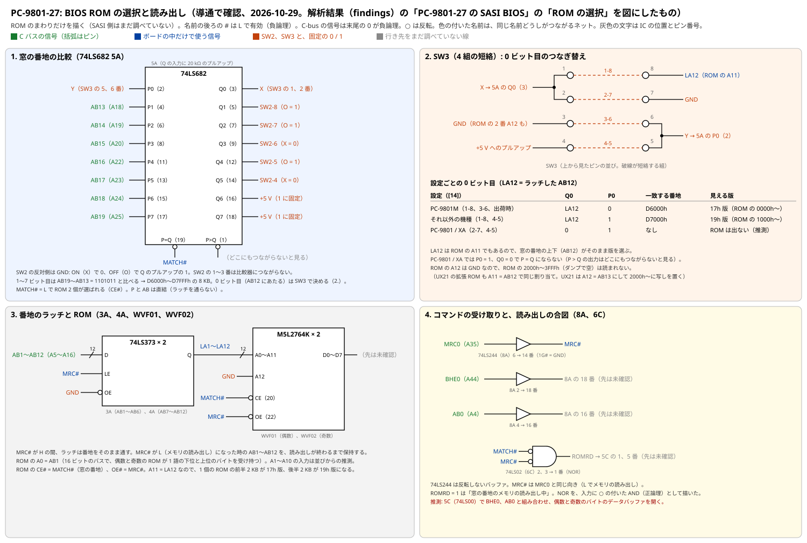

# PC-9801-27 の解析結果

PC-9801-27 は、C-bus に挿す NEC の SASI のインターフェースボード（50 ピンのアンフェノールのコネクタと、SASI BIOS の ROM を載せる）。
タグ（[測定]、[資料 n]、[解析]、[要確認]）の意味は [README](README.md)。

## PC-9801-27 の ROM とボード（2026-10-22〜）

出典: ROM（WVF01-01 と WVF02-01。偶数・奇数の 8 ビット ROM）のダンプの解析[[47]](references.md#ref-47)。ダンプ、逆アセンブル、ROM の中の命令の番地は公開しない。

### ROM の中身（16 KB） [解析]

| オフセット | 大きさ | 中身 |
|---|---|---|
| 0000h | 4 KB | FDD（640 KB I/F、DA = 7xh）+ SASI の拡張 DISK BIOS。000Bh = 17h、ID テーブルに D7h を書く |
| 1000h | 4 KB | FDD（1 MB I/F、DA = 9xh）+ SASI の拡張 DISK BIOS。000Bh = 19h、ID テーブルに D9h を書く |
| 2000h〜3FFFh | 8 KB | 空（FFh） |

- 構成は UX21 の本体 ROM（27h 版と 29h 版）と同じ考え方で、FDD の拡張 BIOS と SASI BIOS が 1 つの 4 KB に同居し、640 KB I/F 用と
  1 MB I/F 用の 2 つの版がある。UX の ROM とは中身が 3,000 バイト以上異なる別の版。
- [資料 1] Undocumented 9801[[1]](references.md#ref-1) の拡張 ROM ID の表で「D9h = PC-9801-27」とされているのは 19h 版。本体の BIOS には、初期化 1 のあとで
  ID D7h か D9h を探して待ち時間を入れるもの（ES2 など）があり、この 2 つの版に対応する。 [/資料]
- ヘッダは同じ形（0009h = 55h AAh、000Ch / 000Fh = 初期化、0015h = ブート、0018h = INT 1Bh）。加えて 0000h に JMP があり、
  PC-9801 初代用のエントリも持つ（Undocumented 9801[[1]](references.md#ref-1) の memsys.txt の記述と一致）。
- INT 1Bh の入口は、AL の bit6〜4 が立っていれば（DA = 1xh、7xh、9xh などの FDD）FDD の処理へ、そうでなければ SASI の処理へ
  分ける。1 つの入口で FDD と SASI の両方を受ける。

### ボード上の設定（出典: 「PC-9801 拡張ボードの設定」radioc.web.fc2.com の pc980109[[14]](references.md#ref-14)。O = OFF（開放）、X = ON（短絡）） [資料 14]

- SW1（8 ピン、ドライブの設定）: 1、2 = 1 台目、2 台目のセクタ長（X = 256 バイト、O = 512 バイト）。3〜5 = 1 台目の容量、
  6〜8 = 2 台目の容量（XXX = 5 MB、XXO = 10 MB、OXX = 20 MB、OOX = 40 MB、OOO = 未接続）。出荷時は XXXXXOOO。
  - これは I/O 82h（NRDSW = 0）で読める容量コード（Undocumented 9801[[1]](references.md#ref-1) の 000b = 5 MB、001b = 10 MB、100b = 20 MB、110b = 40 MB、111b = 未接続）を、
    ON = 0 として並べたものと一致する。DIP スイッチで選べるのはこの 4 種類だけで、010b、011b、101b は選べない。
- SW2（8 ピン、BIOS ROM のアドレス）: 「D6000h に固定」、設定は OOOXOXOO と書かれている。
- SW3（4 組の短絡、BIOS ROM のアドレスと機種）: 1-8 と 3-6 = PC-9801M（出荷時）、2-7 と 4-5 = PC-9801 または PC-98XA、1-8 と 4-5 = それ以外の機種。

### 基板の部品（部品面の写真から読んだもの、2026-10-29。基板の番号 136-453175-C-03） [測定]

- 位置は基板の印刷の格子（列 1〜10 は右から左、行 A〜E は下から上）。

  | 行 | 10 | 9 | 8 | 7 | 6 | 5 | 4 | 3 | 2 | 1 |
  |---|---|---|---|---|---|---|---|---|---|---|
  | E | 空き | 空き | 空き | 7438 | 74LS240 | 74LS240 | 74LS373 | 74LS373 | 74LS273 | SW1 |
  | D | 74LS02 | 74LS02 | 74LS08 | 7404 | 7438 | 7438 | 74LS257A | 74LS257A | — | SW3 |
  | C | 74LS74A | 74LS74A | 74LS04 | 74LS51 | 74LS02 | 74LS00 | ROM | ROM | ROM | SW2 |
  | B | 74LS04 | 74LS00 | 74LS32 | 7438 | 74LS139 | 74LS138 | ROM WVF01 | ROM WVF01 | ROM WVF02 | 74LS245 |
  | A | 74LS74A | 74LS175 | 74LS244 | 74LS14（74LS14PC） | 空き | 74LS682 | 74LS373 | 74LS373 | 74LS244 | 74LS244 |

  - ROM は三菱の M5L2764K（8 KB の UV-EPROM）× 2 個（WVF01 が偶数、WVF02 が奇数）。2764 の 2 番は A12、23 番は A11、22 番は OE#、20 番は CE#。
  - SASI の 50 ピンのアンフェノールのコネクタが上の辺にある。
  - 74LS373 は 3E、4E、3A、4A の 4 個。2E は SN74LS273N、7A は 74LS14PC（2026-10-29）。

### ROM の選択（テスターでの確認、2026-10-29）

[測定]
ROM の番地線はすべて 74LS373 を通り、ROM の OE# の線（74LS244 を通した MRC0）でラッチする。ROM の 2 番（A12）は GND。番地は 74LS682 で比べ、SW3 がその 0 ビット目をつなぎ替える。

ROM の番地線、比較器、SW3 の配線の確かめ（ピンごとの表 3 つを含む、約 60 行）

- ROM の 23 番（A11）は、74LS373（4A。ここに書く 373 はすべて 4A）の 2 番（1Q）。373 の 3 番（1D）は C-bus の A17 番（AB12）。373 の OE#（1 番）は GND、LE（11 番）は ROM の 22 番（OE#）。
  ROM の OE# が L になると、その時の AB12 を保持する（373 の 11 番と ROM の 22 番の導通は、2026-10-29 に改めて確認）。
- ROM の番地線はすべて 74LS373 を通る（テスターでの確認、2026-10-29。2764 のピンの信号名は JEDEC の並び）:

  | ROM | 3A の 373（Q） | 4A の 373（Q） |
  |---|---|---|
  | A0（10 番） | 15 番 | |
  | A1（9 番） | 12 番 | |
  | A2（8 番） | 9 番 | |
  | A3（7 番） | 6 番 | |
  | A4（6 番） | 5 番 | |
  | A5（5 番） | 2 番 | |
  | A6（4 番） | | 15 番 |
  | A7（3 番） | | 12 番 |
  | A8（25 番） | | 9 番 |
  | A9（24 番） | | 6 番 |
  | A10（21 番） | | 5 番 |
  | A11（23 番） | | 2 番（1D = AB12） |

  - 3A の LE（11 番）、4A の LE（11 番）、ROM の 22 番（OE#）は 1 本の線。3A の 14 番（6D。出力 15 番が ROM の A0）は C-bus の A5 番（AB1）。
    よって ROM の A0〜A11 は AB1〜AB12（A1〜A10 の入力は未確認。16 ビットのバスで、偶数と奇数の ROM が 1 語ずつ受け持つ）。
    3A の OE#、3A と 4A の残りのビット（16〜19 番）は未確認。
  - ROM の 22 番（OE#）の線は C-bus の A35 番（MRC0）とはつながらない。この線は 74LS02（6C）の 3 番（1 つ目の NOR の入力 1B）にも入る。
    同じ NOR のもう一方の入力（2 番）は 74LS682 の 19 番（P = Q#）、出力（1 番）は 74LS00（5C）の 1 番と 5 番（2 つの NAND の入力）。
    よって 6C の 1 番は「P = Q# と OE# の線（MRC0。下）がどちらも L」で H。
  - **ROM の OE# の線は、74LS244（8A）を通した MRC0**: C-bus の A35 番（MRC0）は 8A の 6 番（1A3）に入り、出力の 14 番（1Y3）が ROM の 22 番（OE#）と
    3A、4A の LE になる。8A の 1 番（1G#）は GND（いつも有効）。よって番地のラッチは、MRC0 が H の間は素通しで、MRC0 が L になった時の AB1〜AB12 を
    読み出しが終わるまで保持する。
  - 8A の 1 つ目の組のほかの入力: 2 番（1A1）は C-bus の A44 番（BHE0）、4 番（1A2）は A4 番（AB0）（[[3]](references.md#ref-3) 本のページ 273、274）。
    出力は 18 番（1Y1）と 16 番（1Y2）。行き先は未確認。
- ROM の 2 番（A12）は GND。ROM の 2000h〜3FFFh（16 ビットの番地）は読まれず、ダンプで空（FFh）なのと合う。
- 番地の比較器は 74LS682（5A。Q の入力に 20 kΩ のプルアップ[[103]](references.md#ref-103)）。19 番（P = Q#）は ROM 2 個の 20 番（CE#）につながる。
  1〜7 ビット目の行き先（テスターでの確認、2026-10-29。C-bus のピンの信号名は [[3]](references.md#ref-3) 本のページ 273、274）:

  | ビット | P（C-bus） | Q（SW2） | SW2 の設定（[[14]](references.md#ref-14)） |
  |---|---|---|---|
  | 1 | 4 番 = A18（AB13） | 5 番 = 8 番 | O |
  | 2 | 6 番 = A19（AB14） | 7 番 = 7 番 | O |
  | 3 | 8 番 = A20（AB15） | 9 番 = 6 番 | X |
  | 4 | 11 番 = A22（AB16） | 12 番 = 5 番 | O |
  | 5 | 13 番 = A23（AB17） | 14 番 = 4 番 | X |
  | 6 | 15 番 = A24（AB18） | 16 番 = +5 V へのプルアップ（1 に固定） | — |
  | 7 | 17 番 = A25（AB19） | 18 番 = +5 V へのプルアップ（1 に固定） | — |

  - [解析] SW2 の反対側は GND。ON（X）で Q が 0、OFF（O）でプルアップの 1 になるので、1〜5 ビット目は AB17〜AB13 = 0 1 0 1 1。
    6、7 ビット目は 1 に固定。よって比べる値は AB19〜AB13 = 1101011 で、**D6000h〜D7FFFh の 8 KB** を選ぶ。[[14]](references.md#ref-14) の「D6000h に固定」と合う。
    SW2 の 1〜3 番は比較器につながらない（行き先は未確認）。 [/解析]
  - 1 番（P > Q#）は、テスターのダイオードモードで 0.615 V（2026-10-29）。どこにもつながらないかは、導通ではまだ確かめていない。
  - P 側は C-bus に直結（ラッチを通らない）。
  SW3 はその 0 ビット目（2 番 P0、3 番 Q0）をつなぎ替える:

  | SW3 のピン | 行き先 |
  |---|---|
  | 1、2 | Q0 |
  | 8 | ROM の A11（= ラッチした AB12） |
  | 7 | GND |
  | 3 | GND（ROM の 2 番） |
  | 5、6 | P0 |
  | 4 | +5 V へのプルアップ |

  [/測定]

[解析]
- 設定ごとの 0 ビット目（上の配線から）:

  | 設定 | Q0 | P0 | P = Q になる条件 | 読む版（ROM の A11 = AB12） |
  |---|---|---|---|---|
  | PC-9801M（1-8、3-6） | AB12 | 0 | AB12 = 0 | 17h 版（0000h〜） |
  | それ以外（1-8、4-5） | AB12 | 1 | AB12 = 1 | 19h 版（1000h〜） |
  | PC-9801 / XA（2-7、4-5） | 0 | 1 | なし | —（P > Q になる） |

  - -27 も UX21 と同じく、ROM の A11 = AB12 で、窓の番地（4 KB の上下）が版を選ぶ。違いは A12（-27 は GND、UX21 は AB13 で 2000h〜に写しを置く）。
  - よって **M の設定は D6000h に 17h 版、それ以外の設定は D7000h に 19h 版**を出す。Undocumented 9801[[1]](references.md#ref-1) の「M のみ D6000h、ほかは D7000h」と合う。
  - PC-9801 / XA の設定では P = Q# が出ないので、P = Q# は出ない（P > Q# の行き先は未確認）。
  - [要確認] 未確認: SW2 の 1〜3 番の行き先、ROM の OE# を作る回路、3A と 4E の 373 の役割、比較器の 1 番がどこにもつながらないことの導通での確認。 [/要確認]

  [/解析]

### SASI BIOS として見た特徴 [解析]

- 所有者の確認: 19h 版は ES2 の SASI BIOS と同じく、「04B0h が 0 なら登録」「04B0h の持ち主なら初期化 2 とブート」の確認をする。
  17h 版はこの確認をせず、初期化 1 で無条件に 04B0h と 04B8h を書き換える（UX21 の 27h 版と同じ）。
- 新センス（84h）に対応しない。センス（04h）は AH の bit7 を見ずに、いつもパラメータ表の +14h の容量値を返す。
  0000:0480h の bit7 も立てない。Undocumented 9801[[1]](references.md#ref-1) の「PC-9801-27 の BIOS は新センスをサポートしていない」と一致する。
- [資料 16] 未対応の機能（00h のシーク、0Eh のモード設定など）は何もせず AH = 0（正常終了）を返す。bauxite「PC-98x1/disk/ジオメトリ」[[16]](references.md#ref-16)の
  「古めの SASI BIOS では新SENSE コマンドがサポートされていない場合がある。（ちなみに PC-9800 シリーズのテクニカルデータブックには
  『コマンドに該当しないコードが指定された場合は正常終了（CF=0）する』という記述がある。つまり未サポートコマンドは完全スルー）」と一致する。
  同じページは、このときは SENSE（04h）の AH の bit3〜0 の容量の値から、ジオメトリを自分で用意する必要があると書いている。 [/資料]
- パラメータ表は 8 個（1 個 28 バイト）で、厚型／薄型の切り替えはない。ジオメトリの値は ES2、UX21 の表 1 の厚型と同じ
  （000b = 153 × 4、001b = 310 × 4、010b = 310 × 6、011b = 310 × 8、100b = 615 × 4（CHS 計算は 8 ヘッド）、101b = 615 × 6、
  110b = 615 × 8、111b = 未接続）。
- 命令の並び（C2h、READ、WRITE、0000:055Fh の完了待ち）と、CHS → LBA の計算は ES2、UX21 の SASI BIOS と同じ形。

### -27 を挿したときに、どの BIOS が使われるか（2026-11-01）

出典: テクニカルデータブック HARDWARE 1993[[3]](references.md#ref-3)の巻末の ROM 搭載オプションボードの表（402 ページ）と第 1 部 1.4、
テクニカルデータブック 1986[[52]](references.md#ref-52)の機種ごとの FD I/F、Undocumented 9801[[1]](references.md#ref-1)の memsys.txt（0000:0500h bit0、拡張 ROM ID）、
上の -27 の ROM の解析、NEC の SASI BIOS の ROM の解析[[46]](references.md#ref-46)。CPU はテクニカルデータブック 1986[[52]](references.md#ref-52)の第 1 部 2.1（7 ページ）、VX、UX、ES は NEC Retro[[162]](references.md#ref-162)[[163]](references.md#ref-163)[[164]](references.md#ref-164)。

| 機種 | CPU | SASI BIOS | 640 KB FDD BIOS | 1 MB FDD BIOS |
|---|---|---|---|---|
| PC-9801 初代 | 8086 相当、5 MHz | -27（SW3 は「PC-9801 / XA」の設定。どの版がどの番地に出るかは未確認） | 拡張ボード（-08）の ROM（D6000h） | 本体（1 MB I/F 内蔵） |
| E | 8086-2 相当、5 / 8 MHz の切り替え | -27 の 19h 版（D7000h。SW3 は「それ以外」） | 拡張ボード（-09）の ROM（D6000h） | -27 の 19h 版（D7000h）。I/F は -15、その ROM は止める |
| F | 8086-2 相当、5 / 8 MHz の切り替え | -27 の 19h 版（D7000h） | 本体（640 KB I/F 内蔵） | -27 の 19h 版（D7000h）。I/F は -15、その ROM は止める |
| M | 8086-2 相当、5 / 8 MHz の切り替え | -27 の 17h 版（D6000h。SW3 は「M」） | -27 の 17h 版（D6000h）。I/F は -09、その ROM は止める | 本体（1 MB I/F 内蔵） |
| U、VF | V30（μPD70116）、8 MHz | -27 の 19h 版（D7000h） | 本体（640 KB I/F 内蔵） | 本体の BIOS。I/F は -15、その ROM は使わない |
| VM、VX | VM は V30、8 / 10 MHz の切り替え。VX は 80286（8 MHz。VX01、21、41 は 10 MHz）と V30 | -27 の 19h 版（D7000h） | 本体（両用 I/F 内蔵） | 本体（両用 I/F 内蔵） |
| UX | 80286（10 MHz）と V30（切り替え。V30 のクロックは資料で 8 MHz と 10 MHz に分かれる） | -27 の 19h 版（D7000h） | 本体（両用 I/F 内蔵） | 本体（両用 I/F 内蔵） |
| ES | 80386SX（16 MHz）と V30 | 本体の内蔵 SASI BIOS（BANK2、D7000h）と -27 の 19h 版（D7000h）が同じ番地。どちらが出るかは未確認 | 本体（両用 I/F 内蔵） | 本体（両用 I/F 内蔵） |

- [資料 3] 402 ページの表: 640 KB FD I/F（-08、-09）の ROM は工場出荷時 D6000h、1 MB FD I/F（-15）は D7000h、固定ディスク I/F（-07、-27）は D7000h。
  注 1「U2 以降の機種では、640 KB FD、1 MB FD インターフェイスは本体 ROM を使用」。注 2「-27 を使うときは、640 KB FD、1 MB FD インターフェイスの ROM を KILL すること」。
  第 1 部 1.4: E は -09 と -15、F1〜F3、U2、VF2 は -15、M2、M3 は -09 でもう片方の I/F を足す。VM、UV、UX 以降は両方を内蔵する。 [/資料]
- [資料 52] 640 KB 型の FD I/F を内蔵するのは F / U / VF、1 MB 型は初代と M、両用型は UV / VM。初代の 640 KB は -08 で足す。 [/資料]
- [解析] -27 の ROM の FDD 部分は、0000:0500h の bit0 が 0 の機種（[資料 1] 初代、E、F、M、PC-98LT、HA、DB-P1、ハイレゾモード [/資料]）だけで働く。
  17h 版は 640 KB I/F（DA = 7xh、I/O C8h）、19h 版は 1 MB I/F（DA = 9xh、I/O 90h）の BIOS を持つ。VM 以降の機種（0500h の bit0 = 1）では FDD 部分は働かず、SASI だけが働く。
  17h 版は M の設定の D6000h（-09 の ROM の番地）、19h 版はそれ以外の設定の D7000h（-15 の ROM の番地）に出るので、それぞれ止めた ROM の代わりを務める。 [/解析]
- U、VF: [資料 52] 640 KB 型の I/F を内蔵する [/資料]。[資料 1] 0000:0500h の bit0 は 1（「その他」。U は機種情報 1110） [/資料] なので、-27 の FDD 部分は働かない。
  1 MB の I/F は -15 で足すが、注 1 のとおり U2 以降は本体 ROM が 1 MB FD の BIOS も受け持つ。-15 の ROM をジャンパで止めるのかは、-15 のマニュアルで未確認。
- 表の「止める」は注 2 の KILL（ボードの ROM をジャンパで止める）。E の 640 KB の -09 の ROM（D6000h）は、19h 版（D7000h）と番地が重ならないが、注 2 は 640 KB の ROM も止めるとしている。
  止めると 640 KB の FDD の BIOS がなくなるので、E でどうするかは未確認。
- UX の本体の拡張 ROM（SASI BIOS 29h 版、D7000h）が、UX-31 を外して -27 を挿したときに出るかは未確認（UX-31 が SASI_CONFIG# を GND に落としている）。
- -15 の ROM の中身（1 MB FDD の BIOS）は読んでいない。
