# PC-9801UX-31 の解析結果

PC-9801UX-31 は、PC-9801UX の純正のハードディスクユニット（ホストアダプタ、SASI → ST-506 のコントローラ、ドライブ NEC D3126 の 3 段）。
横から見た置き方と寸法、中のバスの図は 1 章の[写真と図](#ux31-figures)。タグ（[測定]、[資料 n]、[解析]、[要確認]）の意味は [README](README.md)。

<details>
<summary>目次（章と項、17 行）</summary>

- [1. ユニット](#1-ユニット)
  - [構成と本体の側](#ux31-unit)
  - [写真と図](#ux31-figures)
- [2. ホストアダプタ](#2-ホストアダプタ)
  - [部品、ピン配置、I/O ポートと回路](#ux31-known)
  - [UX-31 のホストアダプタの論理（式、2026-10-25）](#ux31-logic)
- [3. コントローラ](#3-コントローラ)
  - [概要](#ux31-controller)
  - [UX-31 のコントローラのファームウェア（DS300B-520）の振る舞い](#ux31-firmware)
- [4. ドライブ](#4-ドライブ)
  - [概要と設定](#ux31-drive)
- [5. SASI との関係](#5-sasi-との関係)
  - [RST の使い方と、コントローラがないときの見え方（2026-10-27）](#ux31-rst)
  - [SASI の規格（X3T9.3）との対応（2026-10-26）](#sasi-standard)
- [6. 未解決](#ux31-open)
  - [ホストアダプタと本体](#ホストアダプタと本体)
  - [コントローラ](#コントローラ)

</details>

## 1. ユニット

ホストアダプタ、コントローラ、ドライブの 3 段を重ねたユニット。2 章から 4 章で段ごとに書き、この章には全体のことを書く。

### 構成と本体の側
<a id="ux31-unit"></a>

#### ユニットの構成（PC-9801UX-31、写真と分解、2026-10-22）
- [測定] 3 段の重ね: 下（マザーボードの側）から SASI ホストアダプタ（基板 136-454836-B-02。はんだ面が上で、部品面の P2 がマザーボードの P2 に直接挿さる）、SASI→ST-506 のコントローラ（134-856238-0-3。部品面が下）、ドライブ NEC D3126（3.5 インチ、20 MB、ST-506）。 [/測定]

#### マザーボード側（PC-9801UX） [測定]

- 本体 ROM の SASI BIOS（拡張 ROM の D7000h の窓）は、PAL（U7）が SASI_CONFIG# を見て出す。SASI_CONFIG# はプルアップされていて、**L で SASI BIOS が出る**。
- ジャンパ SW7（2 × 4 ピン）: 3 番 = 4 番 = SASI_CONFIG#、5 番 = P2-36、6 番 = NC（導通の確認、2026-10-25）。
  5-4 で SASI から起動し、6-3 で N88-BASIC が起動する（実機で確認）。調べた実機では 5-4 に挿してあった。
- UX-31 は P2-36 を GND に落としている（約 0.6 Ω）。5-4 のとき、UX-31 を挿すと SASI_CONFIG# = L になり SASI BIOS が出る（ユニットの有無の検出）。
  エミュレータも P2-36 を GND に落とせばよい。

#### 本体の前面の HDD の LED（P3。2026-11-24）
<a id="ux-hdd-led"></a>

- [測定] 2026-11-24。マザーボードの前面の LED のコネクタ P3（3 ピン）は、1 番から 5V、POWER、HDD。線の色は 1 番から灰（GR）、白（W）、赤（R）。HDD のピン（3 番）と P2-39 の間は 220 Ω。 [/測定]
- [解析] LED の片側が +5 V なので、HDD の LED は +5 V → LED → P3 の HDD → 220 Ω → P2-39 の道で点く。UX-31 は P2-39 を 7407（オープンコレクタ）で駆動するので、**P2-39 = L で点き、放す（H）と消える**。7407 は反転しないので、P1-24 も L で点く。 [/解析]
- [測定] 2026-11-24。前面の LED の板（窓は左が POWER、右が DISK）は、灰（GR）が 2 つの LED のアノードの共通、白（W）が POWER（緑）のカソード、赤（R）が DISK のカソード（板の写真と、テスタのダイオードのレンジで灰 → 赤で DISK、灰 → 白で POWER が光ることで確かめた）。電流の道は +5 V（P3-1）→ DISK の LED → P3-3 → 220 Ω → P2-39。 [/測定]
- 点いているときに P2-39 から吸い込む電流は 10 mA 余り（220 Ω と LED の順電圧から）。エミュレータや SASIHBA は、オープンドレインで L に引けばよい。

<a href="photos/ux_mainboard_p3.jpg">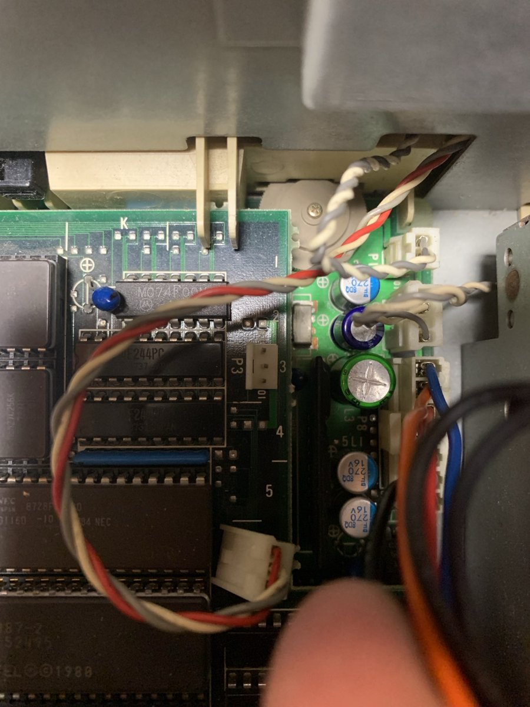</a><br>マザーボードの P3（中央の白い 3 ピンのコネクタ。前面の LED の線。2026-11-24 に撮影）

### 写真と図
<a id="ux31-figures"></a>
ユニットは 3 段で、下（マザーボードの側）からホストアダプタ、コントローラの基板（SASI → ST-506）、ドライブ（NEC D3126）。

#### 横から見た図と、中のバスの図

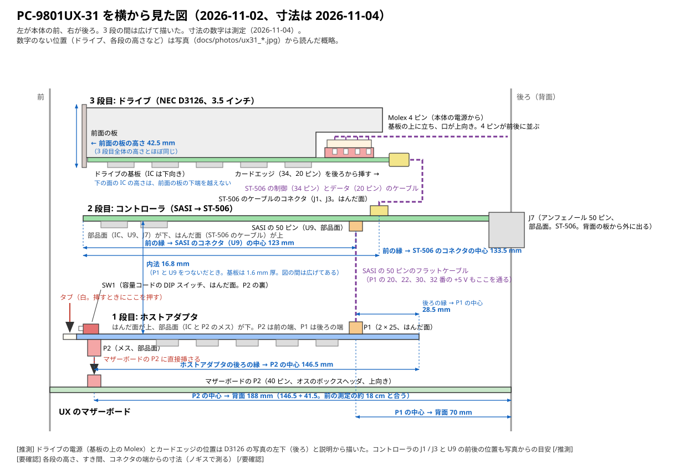

横から見た図（3 段の置き方。寸法は 2026-11-04 の測定）。

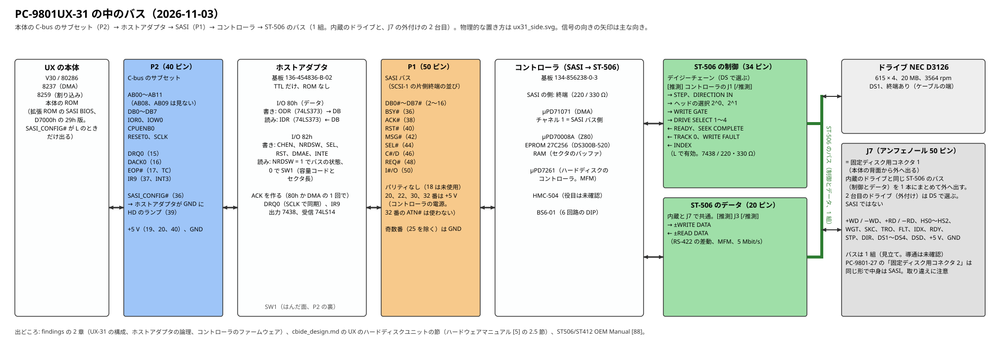

中のバスの図（P2 → ホストアダプタ → P1 → コントローラ → ST-506 のバスと J7。上の図の物理的なつながりを補う）。

#### PC-9801UX-31 の写真（2026-10-26 に撮り直し。台紙の部分を切り取り、縮小した）

<table>
<tr>
<td><a href="photos/ux31_host_board.jpg">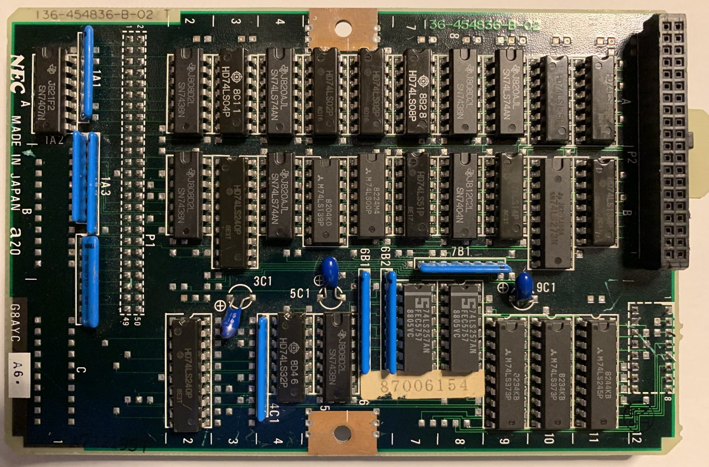</a><br>ホストアダプタ（部品面。右端が P2）</td>
<td><a href="photos/ux31_host_board_solder.jpg">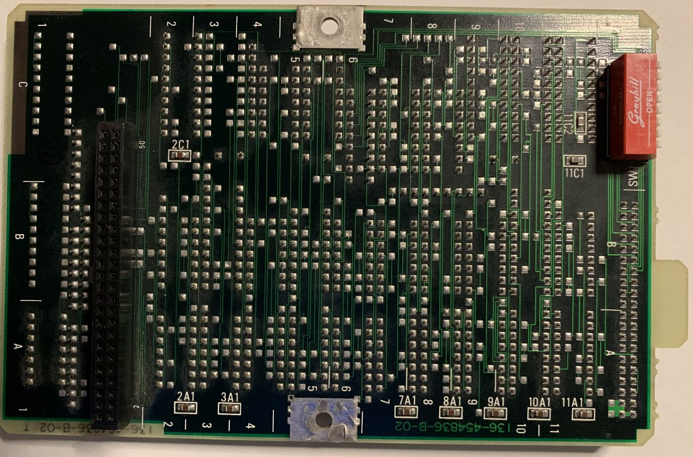</a><br>ホストアダプタ（はんだ面。左に P1、右上に SW1）</td>
</tr>
<tr>
<td><a href="photos/ux31_controller.jpg">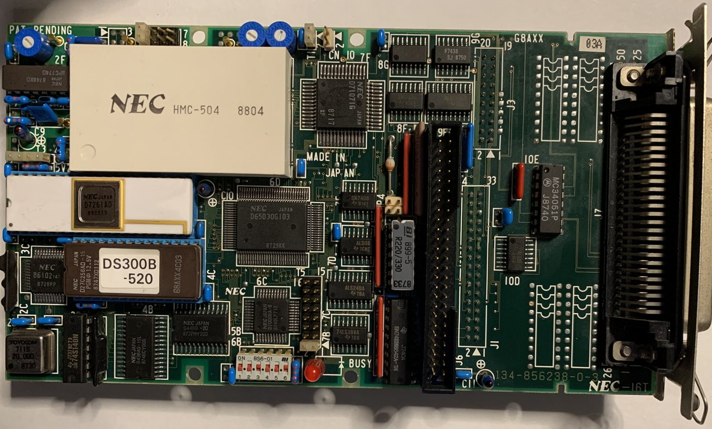</a><br>コントローラの基板（部品面。右端が J7、左下に EPROM と BUSY の LED）</td>
<td><a href="photos/ux31_controller_solder.jpg">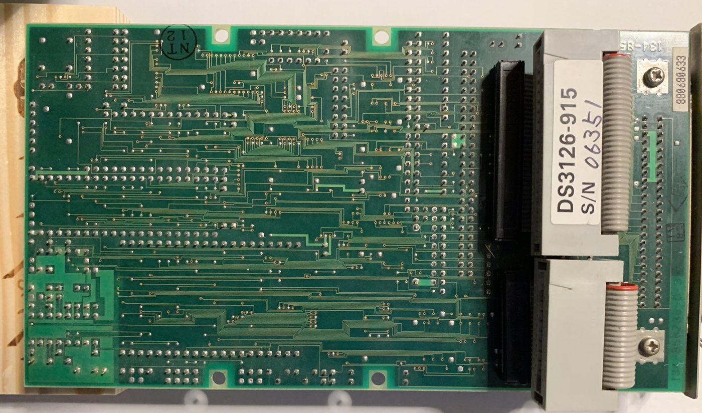</a><br>コントローラの基板（はんだ面。ST-506 のケーブル。左端は台の板）</td>
</tr>
<tr>
<td><a href="photos/ux31_d3126.jpg">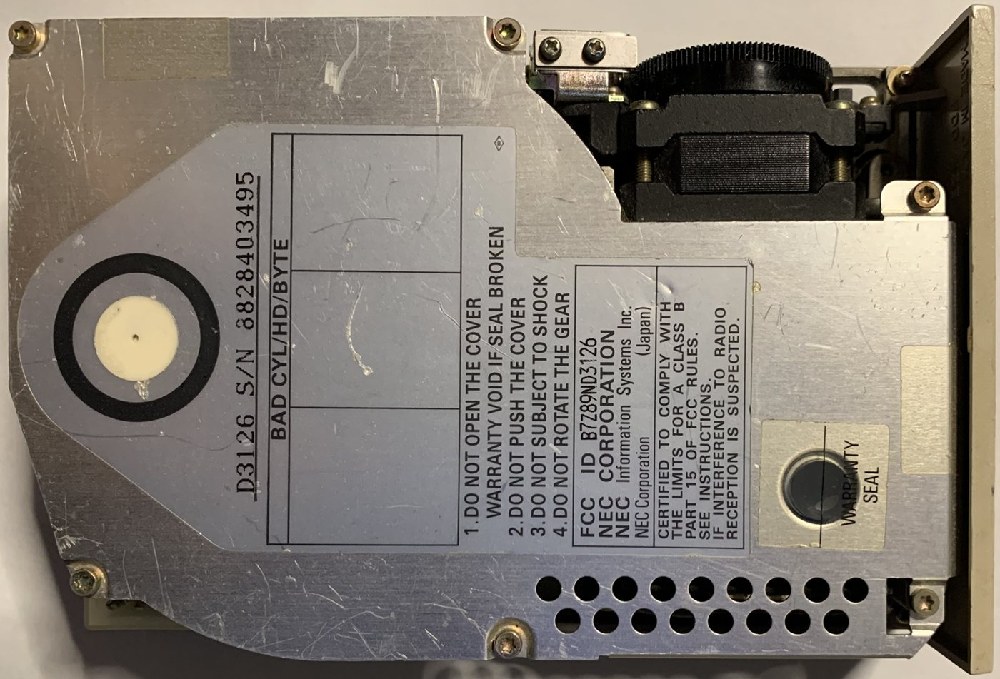</a><br>ドライブ（NEC D3126）</td>
<td><a href="photos/ux31_d3126_pcb.jpg">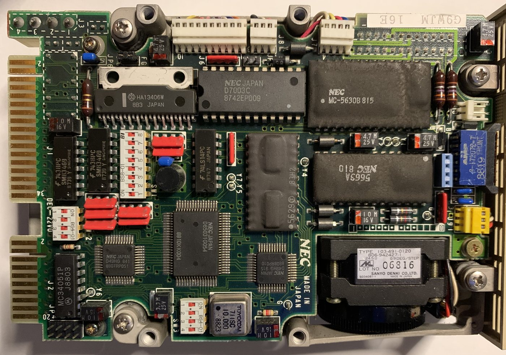</a><br>D3126 の基板</td>
</tr>
<tr>
<td><a href="photos/ux31_unit_front.jpg">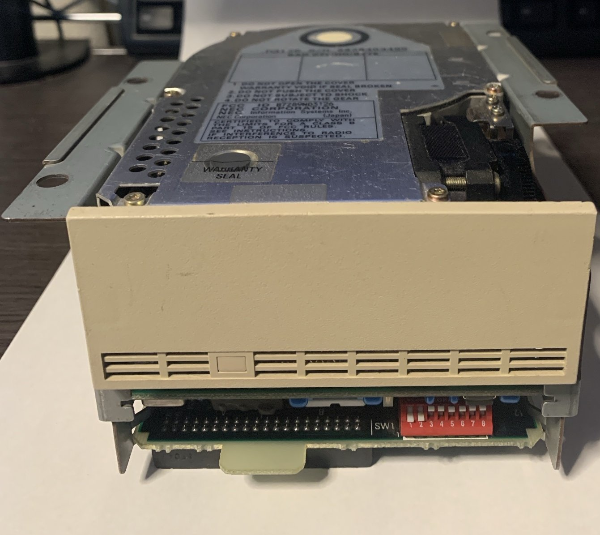</a><br>組んだユニット（前から。前面の板の下に、ホストアダプタの SW1 と白いタブ）</td>
<td><a href="photos/ux31_unit_rear.jpg">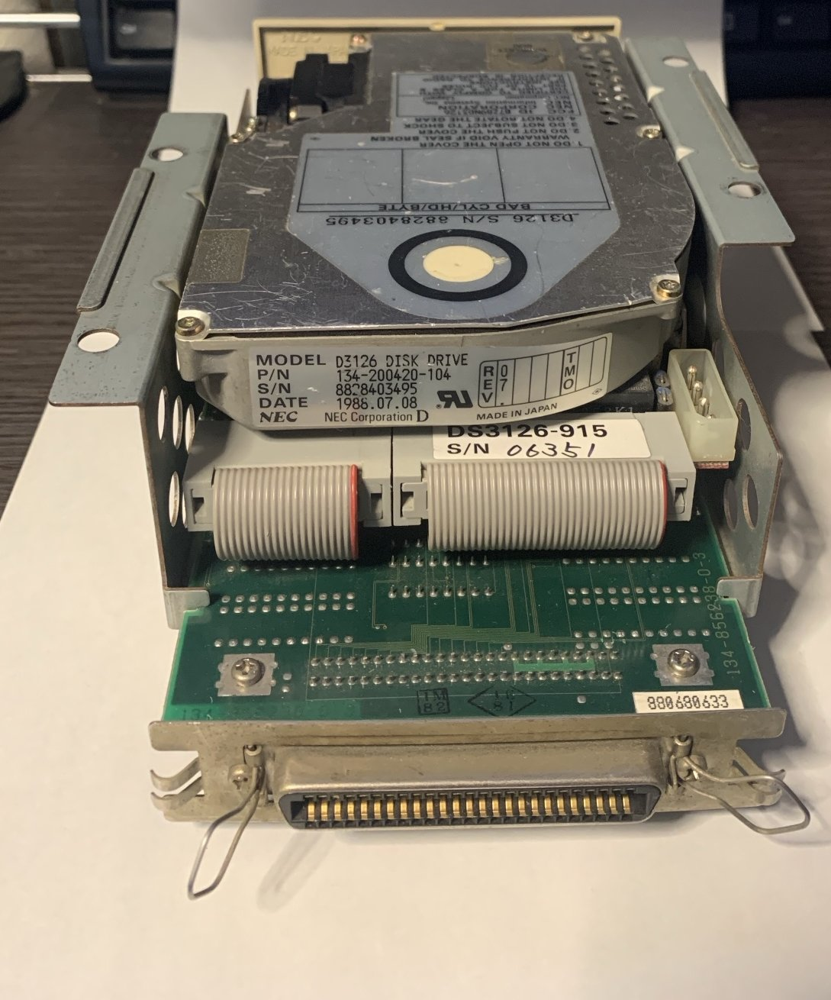</a><br>組んだユニット（後ろから。ST-506 のケーブル 2 本、右に Molex、下に J7）</td>
</tr>
<tr>
<td><a href="photos/ux31_unit_rear_left.jpg">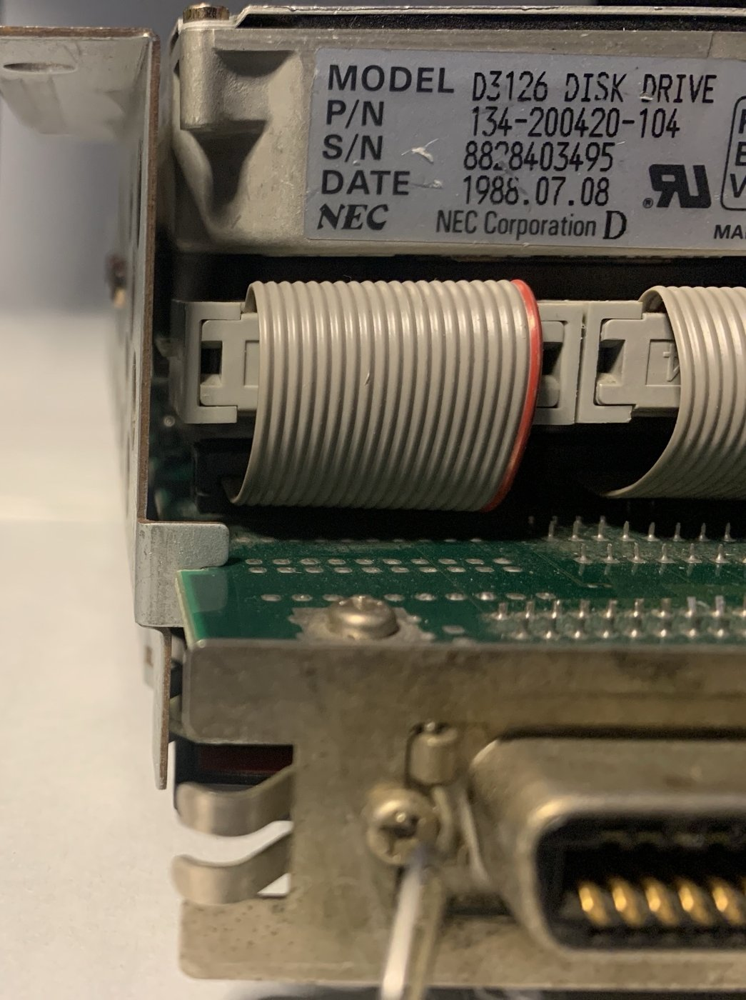</a><br>後ろの左の端（コントローラの基板と台の板）</td>
<td><a href="photos/ux31_unit_rear_right.jpg">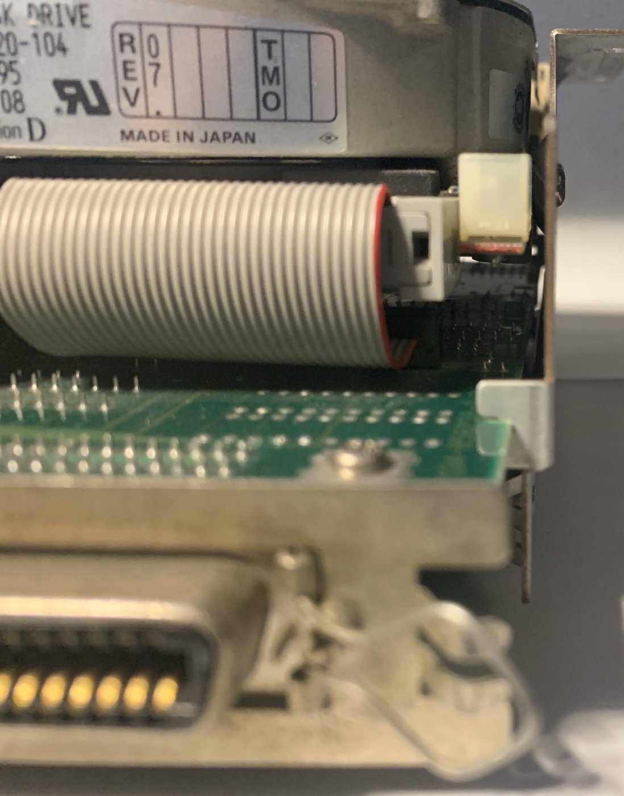</a><br>後ろの右の端（Molex と台の板）</td>
</tr>
</table>

組んだユニットの 4 枚は 2026-11-05 に撮った（背景を切り取り、縮小し、EXIF を消した）。ラベルの読み:

- ドライブ: MODEL D3126 DISK DRIVE、P/N 134-200420-104、S/N 8828403495、DATE 1988.07.08、REV 07。
- ドライブの下の白いラベル: DS3126-915、S/N 06351（手書き）。
- コントローラの基板: 134-856238-0-3（上の表と同じ）、シール 880680633。

## 2. ホストアダプタ

C-bus のサブセット（P2）と SASI バス（P1）の間をつなぐ、TTL だけの基板。

### 部品、ピン配置、I/O ポートと回路
<a id="ux31-known"></a>

#### ホストアダプタの概要（写真と分解、2026-10-22）
- [測定] ホストアダプタは TTL だけで、ROM はない。SASI BIOS は本体の ROM にある。マザーボードへは 40 ピンの P2、コントローラへは 50 ピンの P1 でつながる。
  はんだ面に 8 回路の DIP スイッチ SW1（Grayhill）がある。PC-9801-27 の SW1 に当たり、82h を RDSW = 0 で読むと D7〜D0 = SW1〜SW8 が出る（閉 = 0）。
  今の設定は C C O C C O O O（C = 閉）で、セクタ長 256 バイト × 2、1 台目 100b（20 MB）、2 台目 111b（未接続）と読め、D3126（20 MB）1 台と合う（2026-10-25）。 [/測定]

#### P2（40 ピン）のピン配置（マザーボード側、2026-10-25 に全ピン確定）

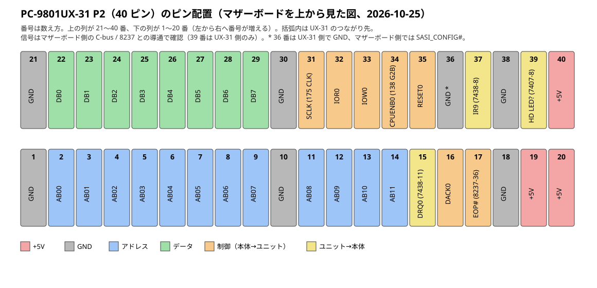（インターフェース側から見た左右反転の図は [figures/ux31_p2_mirror.svg](figures/ux31_p2_mirror.svg)）

[測定]

| P2 | 信号 | つながり先（マザーボード側） |
|---|---|---|
| 2〜9 | AB00〜AB07（2 = AB00） | C-bus の A4〜A10、A12 |
| 11、12 | AB08、AB09 | C-bus の A13、A14 |
| 13、14 | AB10、AB11 | C-bus の A15、A16 |
| 22〜29 | DB0〜DB7（22 = DB0、29 = DB7） | C-bus の B4〜B10、B12 |
| 32 | IOR0 | C-bus の A33 |
| 33 | IOW0 | C-bus の A34 |
| 34 | CPUENB0 | C-bus の A42 |
| 35 | RESET0 | C-bus の B34 |
| 31 | SCLK | C-bus の A46 |
| 15 | DRQ0 | C-bus の B37 |
| 16 | DACK0 | C-bus の B35 |
| 17 | EOP#（DMA の終了、L で有効、双方向） | DMA コントローラ D8237AC-5 の 36 番ピンに直結（C-bus の DMATC0 とは別） |
| 37 | IR9（INT3） | C-bus の B27 |
| 36 | SASI_CONFIG# | ジャンパ SW7 の 5 番（UX-31 側では GND） |
| 39 | UX-31 の 7407 の出力（入力は P1-24） | C-bus にはない（マザーボード側の行き先は未確認） |
| 1、10、18、21、30、38 | GND | GND |
| 19、20、40 | +5 V | （UX-31 の 74LS138 の Vcc と導通） |

- C-bus にもある信号は、間にバッファがなく C-bus スロットと直結している（EOP# だけは C-bus の DMATC0 ではなく 8237 から直接来る）。メモリ読み出しの信号、AB12 以上、DB8 以上、IORDY はない。
- C-bus との対応の見取り図: [figures/ux_p2_cbus.svg](figures/ux_p2_cbus.svg)。下の段は、RA2 などのハードディスク専用スロットの SASI の側（[[12]](references.md#ref-12)）。

[/測定]

#### I/O ポート（UX のハードウェアマニュアル[[5]](references.md#ref-5) 本のページ 76、95） [資料 5]

- 80h: データ（読み = IDR、書き = ODR）。82h の読み: RDSW = 0 で SW1〜SW8（D7〜D0）、RDSW = 1 で REQ、ACK、BSY、MSG、C/D、I/O、−、INT。
  82h の書き: CHEN、RDSW、SEL、0、RST、0、DMAE、INTE。外付けの PC-9801-27 と同じ形。
- マニュアルが決めているのは AB00〜AB07 だけ（ビット 15〜8 はデコードしない）。84h、86h は Reserved。

#### UX-31 のホストアダプタの回路（導通で確定した分、2026-10-25 にまとめ直し。図は論理記号で描いた [figures/ux31_flow.svg](figures/ux31_flow.svg) と、IC とピンの箱で描いた [figures/ux31_blocks.svg](figures/ux31_blocks.svg)）

信号の流れを論理記号で描いた図（正論理。下の[UX-31 のホストアダプタの論理（式）](#ux31-logic)を図にしたもの）:

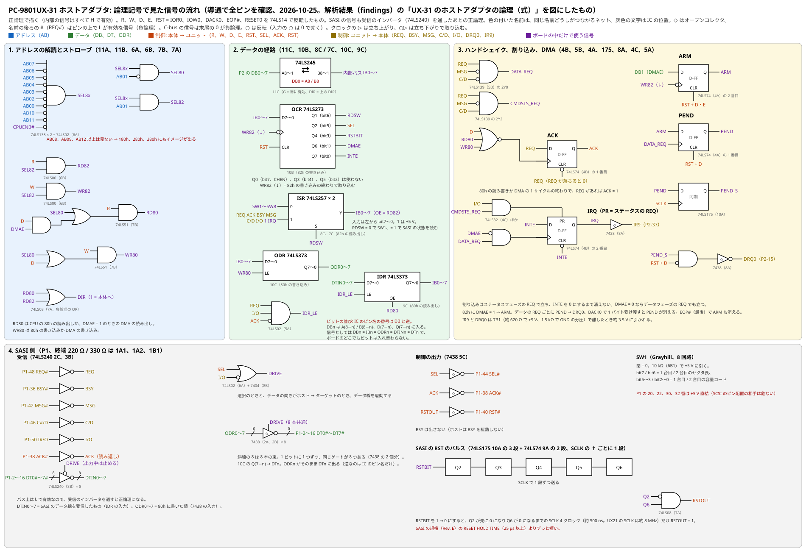

同じ回路を IC とピンの箱で描いた図:

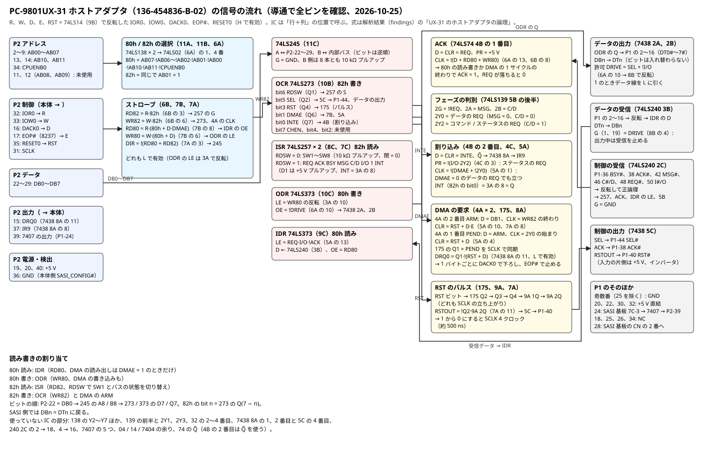

[測定]
IC のピン名の番号はデータのビットと逆: P2-22 = DB0 → 74LS245（11C）の A8 / B8 → 74LS373、74LS273 の D7 / Q7。したがって 82h の bit n は 74LS273 の Q(7 − n)。ビットそのものはボードのどこでも入れ替わらず、DBn = IBn = ODRn = DTn（逆なのは標準ロジック IC のピン名の番号だけ）。

*アドレスとストローブ*
- 80h / 82h の選択: 74LS138 × 2（11A、11B）と 74LS02（6A）。条件は AB07 = 1、AB06〜AB02 = 0、AB00 = 0、AB10 = AB11 = 0、CPUENB0 = L。AB01 で 80h と 82h を分ける。
  AB08、AB09 は使っていない（P2-11、12 は UX-31 側でどこにもつながらない。ダイオードモードで OL（2026-10-25））。したがって 080h / 082h のイメージが 180h、280h、380h（と 1000h ごと）にも出る。
- 入力の受け: IOR0、IOW0、DACK0、EOP#、RESET0 は 74LS14（9B）で受ける（反転した R、W、D）。RESET0 は 7404（8B）でもう一度反転し、74LS273 と 74LS175 の CLR（1 番）に入る。
- 82h の読み出し = 74LS00（6B）の 3 番（NAND(R, 82h)）→ 74LS257 × 2 の G。82h の書き込み = 74LS00 の 6 番（NAND(W, 82h)）→ 74LS273 の CLK。
- 80h の読み出し（IDR の OE）= 74LS51（7B）の 8 番 = NOT(R·(D·DMAE + 80h))。DMAE が立っているときだけ DACK0 + IOR でも読める。
- 74LS245（11C）の向き（DIR、1 番）= 74LS08（7A）の 3 番 = AND(80h の読み出しのストローブ（7A の 1 番）, 82h の読み出しのストローブ（7A の 2 番 = 74LS00 6B の 3 番 = 74LS257 の G））（2026-10-25）。80h か 82h を読むときだけ L になり、ボードから本体へ向く。
- 80h の書き込み（ODR のストローブ）= 74LS51（7B）の 6 番 = NOT(W·(80h + D))（2A = 2C = W、2B = 80h の選択、2D = D（2026-10-25））。DMA の書き込み（DACK0 + IOW）は DMAE を見ない。

*82h の書き込み（OCR、74LS273、10B）*

| bit | 273 | 信号 | 行き先 |
|---|---|---|---|
| 7 | Q0（2） | CHEN | なし（UX-31 では未使用。ダイオードモードで 0.63 V） |
| 6 | Q1（5） | RDSW | 74LS257（8C、7C）の S |
| 5 | Q2（6） | SEL | 7438（5C）の 2 番 → 3 番 → P1-44 |
| 4 | Q3（9） | — | なし（0.63 V） |
| 3 | Q4（12）、D4（13）← 9C の 12 番（DB3 のネット、2026-10-25） | RST | 74LS175（10A）の 5 番（D2）。175 の Q2（7 番）→ D3（12 番）。P1-40 は 5C の 8 番 ← 9 番 ← 74LS08（7A）の 11 番 = AND(175 の 6 番（Q̅2）、74LS74（9A）の 9 番（2Q））（2026-10-25）。RST のビットは 175 の Q2 → Q3 → Q4 → 9A の 1D（2 番）→ 1Q（5 番）→ 2D（12 番）→ 2Q（9 番）と SCLK で送られる（2026-10-25）。1 → 0 にすると Q̅2 が先に 1 になり、2Q が 0 になるまでの 4 クロックだけ AND が 1 になる。UX21 の SCLK は約 8 MHz（7.9872 MHz。[資料 1] 0000:0501h の bit7 = 1 は 8 MHz 系で、SCLK 7.9872 MHz [/資料]、[測定] 2026-11-14。UX21 の V30 モードで 0501h = E4h [/測定]）なので約 500 ns。マニュアルの「400 ns」より少し長い |
| 2 | Q5（15） | — | なし（0.63 V） |
| 1 | Q6（16） | DMAE | 74LS51（7B）の 12 番、74LS02（5A）の 2 番 |
| 0 | Q7（19） | INTE | 74LS74（4B）の 2 番目の D と CLR（INTE = 0 で割り込みが消える） |

- 7438（5C）の 1、4、10 番は +5 V にプルアップ。5C の 3 つのゲートはインバータとして SASI バス（負論理）を引く: 3 番 → P1-44（SEL#）、6 番 → P1-38（ACK#）、8 番 → P1-40（RST#）。

*82h の読み出し（ISR、74LS257 × 2、8C と 7C）*

| bit | RDSW = 0 | RDSW = 1 | 入り元（RDSW = 1） |
|---|---|---|---|
| 7 | SW1 | REQ | 74LS240（2C）9 番 ← P1-48 |
| 6 | SW2 | ACK | 2C の 12 番 ← 8 番 ← P1-38 |
| 5 | SW3 | BSY | 2C の 14 番 ← 6 番 ← P1-36 |
| 4 | SW4 | MSG | 2C の 7 番 ← P1-42 |
| 3 | SW5 | C/D | 2C の 5 番 ← P1-46 |
| 2 | SW6 | I/O | 2C の 3 番 ← P1-50 |
| 1 | SW7 | 常に 1 | +5 V プルアップ |
| 0 | SW8 | INT | 74LS04（3A）の 8 番（4B の 2 番目の Q） |

- SW1（Grayhill）: 1〜8 番ピンは 10 kΩ で +5 V、9〜16 番ピンは GND（閉 = 0）。SW1〜SW4 → 8C、SW5〜SW8 → 7C の A 入力（2、5、14、11 番）。
  今の設定は C C O C C O O O（256 バイト × 2、1 台目 20 MB、2 台目 未接続）。
- **実機での確かめ（2026-10-29。ホストアダプタだけを P2 に挿し、コントローラとドライブは外し、SW1 = C C O O O O O O。DOS の DEBUG で読んだ）**:
  82h（RDSW = 0）は 3Fh で、SW1 の閉 = 0、SW1〜SW8 = bit7〜bit0 の読みと合う。何もしていないときの 82h（RDSW = 1）は 02h で、bit1 が常に 1（上の表）、BSY = 0（終端で
  SASI の線が H）と合う。055Dh = 00h（2 台とも 111b）。
- 257 の出力は 74LS245 の B 側（8C → B1〜B4、7C → B5〜B8）。IDR（9C）の Q と同じネット。B 側の 8 本はどれも 10 kΩ で +5 V にプルアップ（SW1 を全部開いて確認、2026-10-25）。

*SASI バス（P1）*

[資料 3, 77] テクニカルデータブック[[3]](references.md#ref-3)の PC-9801-27 の SASI コネクタ（362 ページ）、UX-31 の P1、一般的なシングルエンドの SCSI（SCSI-2 の A ケーブル[[77]](references.md#ref-77)）の並び（図は上からこの順）（2026-10-26）: [/資料]

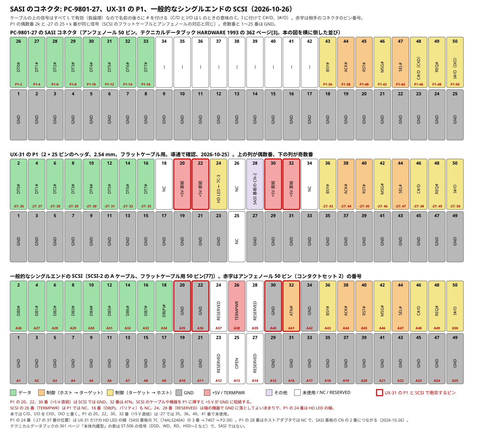

- [資料 3] PC-9801-27 のコネクタ（アンフェノール 50 ピン、362 ページ）: 1〜25 番は GND、26〜33 番 = DT0#〜DT7#、34〜42 番は未使用、
  43 = BSY#、44 = ACK#、45 = RST#、46 = MSG#、47 = SEL#、48 = CXD（C#/D）、49 = REQ#、50 = IXO（I#/O）。注に「ケーブル上ではすべての信号は負論理」とある。 [/資料]
- UX-31 の P1 の偶数番 2k は、-27 の 25 + k 番と同じ信号（SCSI のフラットケーブルとアンフェノールの対応と同じ）。P1 の +5 V 直結の
  20、22、30、32 番は -27 の 35、36、40、41 番（未使用）に、P1 の 24 番（HD LED）は 37 番に当たる。
- [資料 77] 一般的なシングルエンドの SCSI（SCSI-2 の A ケーブル、フラットケーブル用の番号）: 奇数番は GND（23、27 番は RESERVED、25 番は OPEN）、
  2〜16 = DB0#〜DB7#、18 = DB(P)#、20、22 = GND、24 = RESERVED、**26 = TERMPWR**、28 = RESERVED、30 = GND、32 = ATN#、34 = GND、36〜50 は SASI と同じ
  （BSY#、ACK#、RST#、MSG#、SEL#、C#/D、REQ#、I#/O）。アンフェノールでは偶数番 2k が 25 + k 番、奇数番 2k − 1 が k 番（TERMPWR は 38 番）。
  RESERVED は端の機器か終端で GND に落としてよい決まり。TERMPWR はイニシエータがダイオード経由で供給する。
  - **UX-31 の P1 の 20、22、30 番（+5 V 直結）は SCSI では GND、32 番は ATN#** なので、SCSI のケーブルや機器を P1 にそのまま挿すと +5 V が GND に短絡する（図の赤枠）。
    SCSI の 26 番（TERMPWR）と 18 番（パリティ）は P1 では NC。 [/資料]
- [資料 3] 361 ページの「本体内蔵型」の表（1 = DSD、6 / 31 = ±WD、8 / 33 = ±RD、36 = HS2、37 = WGT、38 = SKC、39 = TRO、40 = FLT、41 = HS0、42 = HS1、
  43 = IDX、44 = RDY、45 = STP、46〜49 = DS1〜DS4、50 = DIR）は ST-506 のドライブの信号で、SASI ではない。 [/資料]
- 受け: 74LS240（2C）で BSY#（36）、ACK#（38）、MSG#（42）、C#/D（46）、REQ#（48）、I#/O（50）。
- 出し: 7438（5C）で SEL#（44）、ACK#（38）、RST#（40）。
- データの出力（ODR、上の 74LS373 10C → 7438 2A、2B → P1）（2026-10-25）:

  | 10C | ビット | 7438 の入力 → 出力 | P1 | SASI |
  |---|---|---|---|---|
  | Q7（19） | DB0 | 2B の 12 → 11 | 2 | DT0# |
  | Q6（16） | DB1 | 2B の 9 → 8 | 4 | DT1# |
  | Q5（15） | DB2 | 2B の 5 → 6 | 6 | DT2# |
  | Q4（12） | DB3 | 2B の 2 → 3 | 8 | DT3# |
  | Q3（9） | DB4 | 2A の 12 → 11 | 10 | DT4# |
  | Q2（6） | DB5 | 2A の 9 → 8 | 12 | DT5# |
  | Q1（5） | DB6 | 2A の 5 → 6 | 14 | DT6# |
  | Q0（2） | DB7 | 2A の 2 → 3 | 16 | DT7# |

  本体の DBn が SASI の DTn にそのまま出る（10C の Q(7 − n) が DTn。番号が逆なのは IC のピン名だけで、ビットは入れ替わらない）。P1 の 2、4、…、16 番 = DT0#〜DT7# は、
  PC-9801-27 の並びからの予想どおり。7438 は NAND のオープンコレクタなので、ビットが 1 のとき SASI のデータ線を L（負論理の 1）に引く。
  7438 のもう片方の入力（2A、2B の 1、4、10、13 番）は 8 本とも同じネット（出力の許可）で、入り元は未確認（2026-10-25）。ODR の LE（10C の 11 番）← 74LS04（3A）の 10 番 ← 11 番 ← 74LS51（7B）の 6 番（80h の書き込みのストローブ）（2026-10-25）。書き込みの間 LE が H で素通し、終わりで保持する。ODR の OE（10C の 1 番）= 7404（8B）の 1、3 番 = 74LS02（6A）の 10 番 = NOR(6A の 8 番, 9 番)。7438 の出力の許可（2A、2B の 1、4、10、13 番）= 8B の 2 番 = その反転（2026-10-25）。6A の 8 番 = SEL（74LS273 の 6 番）、9 番 = I/O の反転（74LS04 3A の 2 番）（2026-10-25）。つまり **選択中（SEL = 1）か出力フェーズ（I/O = 0）のとき**、ODR が出力し、7438 が SASI のデータ線を引く。CHEN の代わりにこの条件で出力を決めている。8B の 4 番（同じ条件、H で出力中）は 74LS240（3B）の 19 番（2G）に入り（2026-10-25）、出力中は受信のバッファの後半を止める。
- 74LS245（11C）の G（19 番）は GND（常に有効）（2026-10-25）。向きは DIR だけで決まる。
- データの受信（P1 → 74LS240 3B → 下の 74LS373 9C、IDR）（2026-10-25）:

  | P1 | SASI | 3B の入力 → 出力 | 9C | ビット |
  |---|---|---|---|---|
  | 2 | DT0# | 17 → 3（2Y4） | D7（18） | DB0 |
  | 4 | DT1# | 15 → 5（2Y3） | D6（17） | DB1 |
  | 6 | DT2# | 13 → 7（2Y2） | D5（14） | DB2 |
  | 8 | DT3# | 11 → 9（2Y1） | D4（13） | DB3 |
  | 10 | DT4# | 8 → 12（1Y4） | D3（8） | DB4 |
  | 12 | DT5# | 6 → 14（1Y3） | D2（7） | DB5 |
  | 14 | DT6# | 4 → 16（1Y2） | D1（4） | DB6 |
  | 16 | DT7# | 2 → 18（1Y1） | D0（3） | DB7 |

  P1 → 3B の入力、3B の出力 → 9C の D とも全部確認済み（2026-10-25）。3B の 1、19 番（G）は同じネット（出力中は受信を止める）。74LS240 は反転するので、
  SASI の負論理（L = 1）がそのまま 1 になる。受信も DTn → DBn の順。
- 25 番を除く奇数番は GND。P1-24 → 7407 → P2-39（24 番は +5 V にプルアップ）。**P1-24 を駆動しているのは SASI 基板（コントローラの基板）の 7C（74ALS240A）の 3 番ピン**（2026-10-26。ホストアダプタの 7C（74LS257）とは別の IC）。74ALS240 の 3 番は 2Y4（2A4 = 17 番を反転した 3 ステートの出力、2G = 19 番で許可）なので、HD LED の信号はコントローラが作り、ホストアダプタは 7407 で P2-39 へ中継するだけ。2A4 と 2G の入り元は未確認。P2-39 は L で本体の前面の HDD の LED が点く（1 章の「本体の前面の HDD の LED」）。**20、22、30、32 番は +5 V に直結**。18、26、28、34 番と 25 番はホストアダプタの上ではどこにもつながらない（2026-10-25）。ただし **P1-28 は、P1 が挿さる SASI 基板（SASI → ST-506 のコントローラの基板）の「CN」の 2 番ピンにつながる**（2026-10-26）。CN が何のコネクタか、2 番ピンが何の信号かは未確認。CN の 1 番ピンはどこにもつながっていないように見える（NC、目視、2026-10-26）。

*割り込みと同期*
- IR9（P2-37）: 74LS74（4B）の 2 番目のフリップフロップの Q̅ → 7438（8A）のインバータ → P2-37。D と CLR = INTE、PR = 74LS32（4C）の 3 番、CLK = 74LS02（5A）の 1 番（NOR(DMAE, 74LS139 の 2Y0)）。
- DRQ0（P2-15）: 7438（8A）の 11 番 = NAND(12 番, 13 番)。12 番 ← 74LS175 の 2 番（Q1。74LS74 4A の 1Q を SCLK で同期したもの）、13 番 ← 74LS02（5A）の 4 番（2 番目の NOR の出力。入力 5、6 番は未確認）（2026-10-25）。5A の 4 番 = NOR(RESET（5A の 5、8 番 = 7404 8B の 5 番。H でリセット）, D（5A の 6 番））（2026-10-25）。DACK0 の間とリセット中は DRQ0 を下げ、4A の 1 番目を消す。同じ 5A の 4 番が 74LS74（4A）の 1 番（1CLR）にも入る。
- 74LS74（4A）（2026-10-25）: 1 番目は D ← 4A の 2Q（9 番）、CLK ← 74LS04（3A）の 6 番（← 5 番 ← 5A の 3 番 = 74LS139 の 2Y0。2Y0 が選ばれた瞬間に立ち上がる）、CLR ← 5A の 4 番、PR = +5 V、Q（5 番）→ 74LS175 の D1 → Q1 → DRQ0 のゲート。2 番目は D（12 番）← 7C の 12 番のネット（= 9C の 16 番 = 74LS245 の B7 = **DB1 = DMAE のビット**。このネットは +5 V にプルアップされている）、CLK ← 74LS00（6B）の 6 番（82h の書き込み）、CLR ← 74LS02（5A）の 10 番 = NOR(RESET, 74LS08（7A）の 8 番 = AND(D, 7A の 10 番))、PR = +5 V（2026-10-25、測り直して確認）。7A の 10 番は EOP# の反転（74LS14 9B の 8 番、H で有効）（2026-10-25）なので、DMA の最後のサイクル（DACK0 と EOP# が同時）で 4A の 2 番目が消え、それ以上 DRQ0 を出さない。82h に DMAE = 1 を書くと 2Q が 1 になり、データフェーズ（2Y0）に入ると 1Q に移って SCLK で同期し、DRQ0 の要求になる（導通で確かめた配線から）。（一時「D が +5 V と 7C の 12 番の両方につながるのは誤記では」と書いたが、データバスの B 側にプルアップがあると見れば矛盾しない。）
- 74LS74（9A）の 1CLR（1 番）は RESET（7404 8B の 6 番）（2026-10-25）。
- ACK#（P1-38）: 7438（5C）の 6 番 ← 5 番 ← 74LS74（4B）の 5 番（1 番目のフリップフロップの Q）（2026-10-25）。同じネットが 74LS02（5A）の 11 番（4 番目の NOR の入力）にも行く。4B の 1 番目が ACK のフリップフロップで、1CLR（1 番）と 1D（2 番）は同じ信号（74LS04 3A の 3 番のネット）、1PR（4 番）は +5 V（2026-10-25）。その信号が 0 なら ACK は消え、1 のときに CLK（3 番）の立ち上がりで ACK が立つ。CLK ← 74LS02（6A）の 13 番 = NOR(6A の 11 番, 12 番)（2026-10-25）。D と CLR の信号（3A の 3 番）は **REQ**（74LS240 2C の 9 番）（2026-10-25）。6A の 11 番 = D（DACK0 の反転、74LS14 9B の 6 番。7B の 5 番、5A の 6 番も同じ）、6A の 12 番 = 74LS00（6B）の 8 番 = NAND(6B の 9 番（74LS08 7A の 1 番と同じネット）, 6B の 10 番（= 7B の 6 番、ODR の書き込みのストローブ、L で有効））（2026-10-25）。6B の 9 番のネットは 80h の読み出しのストローブ（7A の 1 番 = 7B の 8 番 = 9C の 1 番、L で有効）（2026-10-25）。したがって ACK の CLK は「CPU の 80h の読み出し、80h の書き込み、DMA の 1 サイクル（DACK0）のどれかが終わった瞬間」に立ち上がり、REQ が出ていれば ACK が立つ。REQ を反転した 3A の 4 番は 74LS139（5B）の 2G（15 番）に入る（2026-10-25）ので、REQ = 1 の間だけ 2 番目のデコーダ（SASI のフェーズの判別）が働く。2A = MSG、2B = C/D（2C の 5 番）（2026-10-25）なので、2Y0 = データフェーズの REQ（MSG = 0、C/D = 0）、2Y2 = コマンドかステータスの REQ（MSG = 0、C/D = 1）。
- IDR（9C）の LE（11 番）= 74LS02（5A）の 13 番 = NOR(ACK, 74LS00（6B）の 11 番)（2026-10-25）。6B の 11 番 = NAND(REQ（13 番 ← 8C の 3 番）, I/O（12 番 ← 2C の 3 番、3A の 1 番、7C の 6 番）)（2026-10-25）。つまり LE は「REQ = 1、I/O = 1（ターゲット → ホスト）、ACK = 0」のときだけ開き、ACK が立つとデータを保持する。
- 74LS175（10A）と 74LS74（9A）は SCLK（P2-31）で動く。175 の D1（4 番）← 74LS74（4A）の 5 番（1Q）。D2（5 番）← RST のビット、D3（12 番）← Q2（7 番）、D4（13 番）← Q3（10 番）で、RST のビットを SCLK で 3 段送る（2026-10-25）。（一度「175 の 13 番と 9C の 12 番が導通」と記録したのは、74LS273 の 13 番の誤り。2026-10-25 に訂正。）
- 使っていないゲート（2026-10-25）: 74LS138 の Y1〜Y7（右は Y2〜Y7）、74LS04（3A）と 74LS14（9B）の 6 番目、7404（8B）の 4〜6 番目、74LS32（4C）の 2〜4 番目、74LS139（5B）の 2Y1、2Y3（メッセージフェーズは判別しない）、74LS74（4B）の 6、9 番（ACK の反転、割り込みの Q）、7438（8A）の 1、2 番目、7438（5C）の 4 番目（ホストは BSY を出さない）、74LS240（2C）の 2 → 18、4 → 16（入力も出力も配線なし。表裏の配線をたどって確認、2026-10-25。入力の約 0.46 V は LS の入力そのものの値）、7407 の 9 → 8 以外の 5 つ。74LS240（2C）の G（1、19 番）は GND、74LS74（9A）の PR（4、10 番）は +5 V にプルアップ。
- 使っていないピン（ダイオードモードで出力が約 0.63 V）: 74LS74（9A、4A）の 6、8 番、74LS175 の 3、11、14 番、74LS139（5B）の前半（出力 4〜7 番。入力 1〜3 番は約 0.55 V）、74LS08（7A）の 2 番目のゲート（出力 6 番）（2026-10-25）。9A の 1PR と 2PR（4、10 番）は互いにつながり、2CLR（13 番）は 175 の CLR（RESET）（2026-10-25）。

[/測定]

### UX-31 のホストアダプタの論理（式、2026-10-25）
<a id="ux31-logic"></a>
導通で確かめた回路を、エミュレータ（CPLD）でそのまま書ける形にまとめる。図は [figures/ux31_flow.svg](figures/ux31_flow.svg)（論理記号）と [figures/ux31_blocks.svg](figures/ux31_blocks.svg)（IC とピン）。

#### 記号

[解析]
**記号**: 内部の信号はすべて H で有効。R = !IOR0、W = !IOW0、D = !DACK0、E = !EOP#、RST = !RESET0（74LS14 で反転したもの）。
SASI のバスの信号（REQ、ACK、BSY、MSG、C/D、I/O、SEL、DT）も、74LS240 / 7438 で反転したあとの正論理で書く（バス上は L で有効）。
↑ は立ち上がり、↓ は立ち下がり、「非同期」はクロックによらず効く CLR / PR。

[/解析]

#### アドレスとストローブ [解析]
```
SEL80 = AB07 & !AB06 & !AB05 & !AB04 & !AB03 & !AB02 & !AB01 & !AB00 & !AB10 & !AB11 & !CPUENB0
SEL82 = （同じで AB01 = 1）                        ; AB08、AB09、AB12〜AB15 は見ない
RD82  = R & SEL82                                  ; 74LS00 6B の 3（L で有効）
WR82  = W & SEL82                                  ; 74LS00 6B の 6
RD80  = R & (SEL80 | D & DMAE)                     ; 74LS51 7B の 8
WR80  = W & (SEL80 | D)                            ; 74LS51 7B の 6
DIR_TO_HOST = RD80 | RD82                          ; 74LS08 7A の 3 → 74LS245 の DIR。G は常に有効
```

#### レジスタ [解析]
```
OCR（74LS273）: WR82 の終わり（WR82 の ↓。基板の上では L で有効の 6B の 6 番の ↑）で DB を取り込む。RST で 0。
  RDSW = DB6、SEL = DB5、RSTBIT = DB3、DMAE = DB1、INTE = DB0（DB7 = CHEN、DB4、DB2 は捨てる）
ISR（74LS257）: RD82 のとき出力
  RDSW = 0: DB7..DB0 = SW1..SW8（閉 = 0）
  RDSW = 1: DB7..DB0 = REQ, ACK, BSY, MSG, C/D, I/O, 1, IRQ
ODR（74LS373）: WR80 の間は素通し、終わりで保持
IDR（74LS373）: IDR_LE = REQ & I/O & !ACK の間は素通し、ACK で保持。RD80 のとき出力
DRIVE = SEL | !I/O                                 ; 74LS02 6A の 10（の反転）
DT[7:0] = DRIVE ? ODR : 開放                       ; DBn → DTn。受信は DRIVE = 0 のときだけ
```

#### ハンドシェイク [解析]
```
ACK: 非同期 CLR = !REQ、D = REQ、CLK = !(D | RD80 | WR80) の ↑
     → CPU の 80h の読み書きか DMA の 1 サイクルが終わったとき、REQ が出ていれば ACK = 1。REQ が落ちると ACK = 0
DATA_REQ   = REQ & !MSG & !C/D                     ; 74LS139 の 2Y0
CMDSTS_REQ = REQ & !MSG &  C/D                     ; 74LS139 の 2Y2（MSG = 1 のフェーズは判別しない）
```

#### 割り込み（IR9） [解析]
```
IRQ: 非同期 CLR = !INTE、非同期 PR = I/O & CMDSTS_REQ（ステータスフェーズ）
     D = INTE、CLK = !(DMAE | !DATA_REQ) の ↑（DMAE = 0 のときデータフェーズの REQ でも立つ）
IR9 = IRQ（オープンコレクタ。本体側のプルアップで H）
```

#### DMA（DRQ0） [解析]
```
ARM:  非同期 CLR = RST | D & E、D = DB1（DMAE）、CLK = WR82 の終わり（WR82 の ↓ = 6B の 6 番の ↑）
PEND: 非同期 CLR = RST | D、D = ARM、CLK = DATA_REQ の ↑
PEND_S = PEND を SCLK の ↑ で同期（74LS175）
DRQ0 = PEND_S & !(RST | D)                        ; オープンコレクタ、C-bus の DRQ00（L で有効）
```
- 82h に DMAE = 1 を書くと ARM が立ち、データフェーズの REQ ごとに PEND → DRQ0。DACK0 で 1 バイト受け渡すと PEND が消え、ACK が立つ。
  8237 の最後のサイクル（DACK0 と EOP#）で ARM も消え、以後 DRQ0 は出ない。

#### SASI の RST [解析]
```
シフト: RSTBIT → Q2 → Q3 → Q4 → Q5 → Q6（SCLK の ↑ ごとに 1 段。74LS175 の 3 段と 74LS74 の 2 段）
RSTOUT = !Q2 & Q6                                  ; RSTBIT を 1 → 0 にすると SCLK 4 クロック（約 500 ns）
```

**ほかの SASI の出力**: SEL = OCR の SEL、ACK = 上の ACK、RST = RSTOUT。BSY は出さない（ホストは BSY を駆動しない）。

#### 基板の集合抵抗（2026-10-25）

集合抵抗 8 個の足の行き先（2026-10-26）:

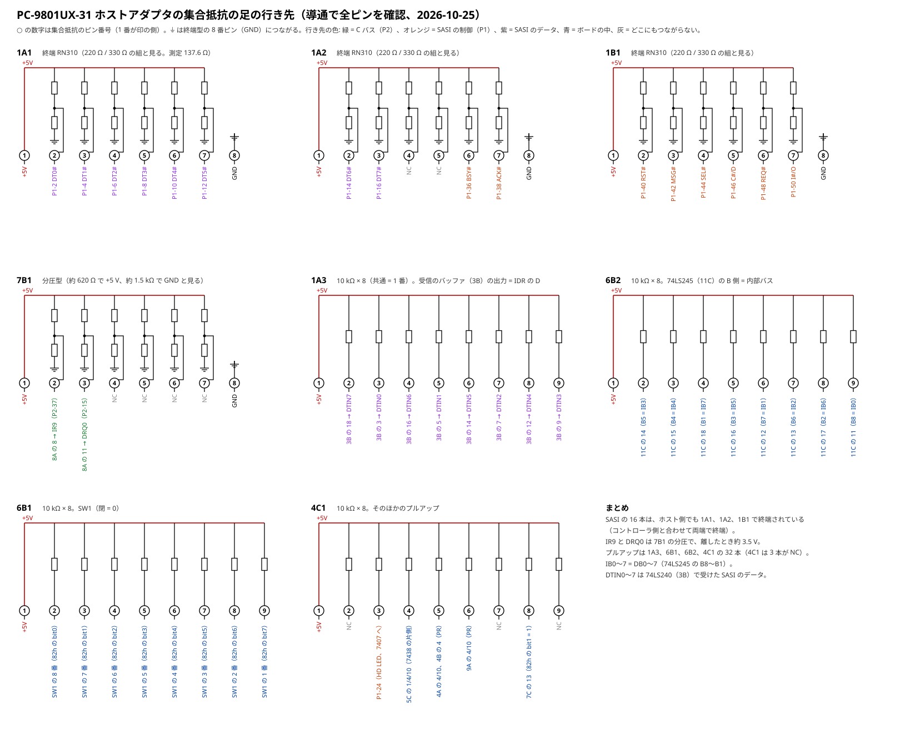

[測定]

| 位置 | 種類 | 値 | 測定と行き先 |
|---|---|---|---|
| 7B1 | 8 ピンの集合抵抗 | 470 Ω | 1 番ピンが +5 V、8 番ピンが GND（2026-10-25）で、終端と同じ形。2 番 = 7438（8A）の 8 番（IR9、P2-37）、3 番 = 8A の 11 番（DRQ0、P2-15）（2026-10-25）。4〜7 番は未確認。ホストアダプタ側でも IR9 と DRQ0 を引いている。抵抗の測定（2026-10-25）: 2 番 ↔ 1 番（+5 V）443 Ω、2 番 ↔ 8 番（GND）454.6 Ω、+5 V ↔ GND 28.7 Ω（終端 16 本の 550 Ω が並列に入る値と合う）。プルアップだけなら GND 側は 470 + 29 ≈ 500 Ω になるはずなので、+5 V 側と GND 側の両方に抵抗がある分圧の形と判断した。式で解くと約 620 Ω（+5 V 側）と約 1.5 kΩ（GND 側）で、離しているときの電圧は約 3.5 V（基板の上での測定なので目安）。印字は「Ψ C001 84」（2026-10-25。値を示す表記ではなく、84 は製造年の可能性）。空きの 4〜7 番でも 1 番との間が 443〜445 Ω、8 番との間が 455〜456 Ω と、2 番とほぼ同じ値（2026-10-25）。IC の経路の影響はなく、集合抵抗そのものの値。**各線に +5 V 側と GND 側の 2 本の抵抗が入る分圧型**で、計算では約 620 Ω（+5 V 側）と約 1.5 kΩ（GND 側）。本体から見ると約 440 Ω を通して約 3.5 V に引かれる形 |
| 6B1、6B2、4C1、1A3 | 9 ピン SIP（共通ピン + 8 本） | 10 kΩ | 共通ピン（1 番）は 4 個とも +5 V（2026-10-25）。1A3 の 2、3、4 番 = 74LS240（3B）の 18、3、16 番（受信のバッファの出力 = IDR の D）。5〜9 番 = 3B の 5、14、7、12、9 番（2026-10-25）。1A3 の 8 本はすべて受信のバッファの出力（IDR の D）のプルアップで、3B が止まっている間（ホストがデータを出している間）に IDR の入力を H に保つ。6B2 の 2〜9 番 = 74LS245（11C）の 14、15、18、16、12、13、17、11 番（B 側の 8 本、2026-10-25）。6B1 の 2〜9 番 = SW1 の 8〜1 番（2026-10-25）。4C1: 3 番 = P1-24、4 番 = 5C の 1 / 4 / 10 番、5 番 = 74LS74 4A の 4 / 10 番と 4B の 4 番（同じネット）、6 番 = 9A の 4 / 10 番、8 番 = 7C の 13 番（2026-10-25）。2、7、9 番はどこにもつながらない（余り）。**ホストアダプタの集合抵抗 8 個の全ピンの行き先が確定**。32 本のプルアップ（1A3 はあとから追加、2026-10-25）。74LS245 の B 側 8 本、SW1 の 8 本、7C の 13 番、5C の 1 / 4 / 10 番、74LS74 の PR、P1-24 などで約 20 本 |
| 1A1、1A2、1B1 | 8 ピン（RN310） | 137.6 Ω（測定値） | 8 番ピンは GND（2026-10-25）。**SASI バスの終端**（行き先は表の下）。220 Ω（+5 V へ）と 330 Ω（GND へ）の組を並べた終端用の集合抵抗なら、信号から見た値は 220 ∥ 330 = 132 Ω で、測定値に近い。1 個に 6 本 × 3 個 = 18 本で、SASI の 16 本（DT0〜DT7、BSY、ACK、RST、MSG、SEL、C/D、REQ、I/O）が収まる |

- 終端の行き先（2026-10-25）: 1A1 の 2〜7 番 = P1 の 2、4、6、8、10、12 番（DT0#〜DT5#）、1A2 の 2、3 番 = P1 の 14、16 番（DT6#、DT7#）、
  1B1 の 2〜7 番 = P1 の 40、42、44、46、48、50 番（RST#、MSG#、SEL#、C#/D、REQ#、I#/O）。1A2 の 6、7 番 = P1 の 36、38 番（BSY#、ACK#）、4、5 番はどこにもつながらない（余り、2026-10-25）。
  1A1、1A2、1B1、7B1 の 1 番ピンは +5 V、8 番ピンは GND（2026-10-25）。**ホスト側にも SASI の 16 本すべての終端がある**（220 Ω / 330 Ω の組かは未確認。測定値は 137.6 Ω）。
- ホストアダプタ側にも終端があるので、SASI バスは両端（ホストアダプタとコントローラ）で終端されている（SCSI と同じ考え方）。コントローラの代わりに
  ターゲット（変換番長やエミュレータ）を挿すときは、ターゲット側にも終端が要る。

[/測定]

#### この式の確かさ（2026-10-25） [測定]
- 使っているゲートの入力は、どれも入り元を導通で確かめた。入力の入り元がすべてわかっていれば、ネットのつながり（ファンアウト）は入力側から全部たどれる。
  74LS273 の D1、D2、D6（RDSW、SEL、DMAE）と 74LS245 の B2、B3、B7（4 ↔ 17、7 ↔ 16、17 ↔ 12 番）も直接当てて導通を確認した（2026-10-25）。
- 使っていないゲートの入力（3A の 13 番、9B の 13 番、4C の 4、5、9、10、12、13 番、5B の 1〜3 番など）は、どこかの信号につながっていても
  出力を使っていないので、論理には効かない（負荷が増えるだけ）。
- プルアップと終端は、基板の集合抵抗 8 個の全ピンを当てて確定した（2026-10-25）。SASI の 16 本はホスト側でも終端されている。IR9 と DRQ0 には分圧型の 7B1 が付く。

## 3. コントローラ

SASI を受けて ST-506 のドライブを動かす基板。Z80 のファームウェアで動く。

### 概要
<a id="ux31-controller"></a>

- [測定] コントローラは μPD70008A（Z80）、μPD7261AD、μPD71071、ファームウェアの EPROM（27C256、DS300B-520）、RAM（μPD4364G-15L = 8 KB と μPD448G-20 = 2 KB）を載せ、SASI バスの終端抵抗（220 Ω / 330 Ω）もこちらにある。
  受け付ける命令、状態バイト、REQUEST SENSE、C2h の形は[ファームウェアの振る舞い](#ux31-firmware)。 [/測定]
- [解析] UX21 の本体 ROM の SASI BIOS は INQUIRY（12h）を出さない（ROM の解析[[46]](references.md#ref-46)）。UX-31 のコントローラも 12h を受け付けない。 [/解析]

### UX-31 のコントローラのファームウェア（DS300B-520）の振る舞い [解析]
<a id="ux31-firmware"></a>
出典: コントローラの EPROM（27C256、DS300B-520）のダンプの解析[[153]](references.md#ref-153)。ダンプ、逆アセンブル、ROM と RAM の中の番地は公開しない。ここには、外から見える振る舞いだけを書く。

#### ハードウェアの使い方 [解析]
- CPU は μPD70008A（Z80）。RAM は 10 KB（μPD4364G-15L の 8 KB と μPD448G-20 の 2 KB の和と合う）で、セクタのバッファ、ID の表（フォーマットの ID と READ ID の結果）、LUN ごとの作業域、共通の作業域、スタックに使う。
  起動時に RAM を検査し、作業域が壊れていれば止まる。
- DMA コントローラ μPD71071 の 1 つのチャネルで、SASI バスの側（コマンドの受け取り、データ、状態の送り出し）を動かす。もう一方のチャネルの使い道は未確認。
- SASI バスの状態を読むポートがあり、「選択された」「転送中」「RST」のビットを見る。RST は実行中の命令の中断として扱い、センスを 1Fh にする。バスの制御（フェーズなど）を書くポートもある。
- 起動時に読むポートのビットで、各フェーズの前に別のビットを待つ動作に切り替わる。基板の 6 回路の DIP スイッチ（BS6-01）との対応は未確認。

#### 受け付ける SASI の命令 [解析]

| 命令 | Group | 内容（命令の名前は Xebec 系の割り当てによる） |
|---|---|---|
| 00h | 0 | TEST UNIT READY。ドライブの状態を見て、準備できていなければセンス 04h など |
| 01h | 0 | REZERO（リキャリブレート） |
| 03h | 0 | REQUEST SENSE。4 バイトを返す（下記） |
| 04h | 0 | FORMAT DRIVE。リキャリブレートのあと、シリンダ 0 から最後のシリンダまで、各シリンダでヘッド 0 から最後のヘッドまで、1 トラックのフォーマット（06h と同じ処理）を順に行う。書いたあとの読み直しはない |
| 05h | 0 | ベリファイ（CHECK TRACK FORMAT 相当。読み出しの処理を共用し、転送しない） |
| 06h | 0 | FORMAT TRACK。シリンダが変わるときだけシークし、セクタごとに 4 バイト（シリンダ、ヘッド、セクタ番号）の ID の表を作り、埋める値 E5h とともにディスクコントローラに 1 回の命令で渡す。インターリーブは 1 に固定で、CDB のインターリーブを使わない |
| 07h | 0 | FORMAT BAD TRACK。そのトラックを、ID のヘッドの bit7 を立てて（不良の印）フォーマットし直す。以後そのトラックを読むとセンス 19h |
| 08h | 0 | READ |
| 0Ah | 0 | WRITE |
| 0Bh | 0 | SEEK |
| 0Eh | 0 | ASSIGN ALTERNATE TRACK。CDB のあとに 4 バイトのデータ（代替トラックの番地）を受け取る。不良のトラックを、ID のシリンダとヘッドに代替トラックの番地を入れ、ヘッドの bit7、bit6 を立てて（代替の印）フォーマットし直し、READ ID で書けたことを確かめる |
| C2h | 6 | ドライブパラメータの設定。CDB のあとに 10 バイトのデータを受け取る（下記） |
| E0h | 7 | RAM の検査。セクタのバッファ全体に模様を書いて読み比べる。模様は 80h から 1 ビットずつずらした 8 通りと、3 バイトごとにその反転を混ぜたもの。食い違えばセンス 30h（RAM のエラー）。ドライブには触れず、作業域は調べない。データの転送はない |
| E2h | 7 | ID の読み出し。CDB の LBA のトラックへシークし、READ ID でそのトラックの ID を読み、最後に読めた ID から 6 バイト（シリンダの下位、シリンダの上位 2 ビット × 10h + ヘッド、セクタ番号、00h、00h、00h）をホストへ送る。読めなければリトライ（CDB のバイト 5 の bit7 による）のあとセンス |
| E3h | 7 | ドライブの検査。リキャリブレートのあと、シリンダ 0 ヘッド 0 から最後まで、トラックごとにシークして READ ID でそのトラックの ID を全部読む。読めなければその番地でセンス。データの転送はない |
| FCh | 7 | E3h と同じ順で全トラックの ID を読み、トラックごとに最後に読めた ID を確かめる。セクタ番号が「読めた ID の数 − 1」でないか、ヘッドが違えばセンス 94h（14h、レコードなし）、シリンダが違えばセンス 95h（15h、シークエラー）。どちらも bit7 = アドレス有効。インターリーブ 1、セクタ番号 0 からのフォーマットを確かめる形 |
| それ以外 | — | センス 20h（不正な命令）で終わる |

- Group は命令コードの上位 3 ビット（Command Group。0 = 6 バイトの CDB、6 と 7 = ベンダー独自）。この実物は Group 1（10 バイトの CDB）を受け付けない。
- E0h、E2h、E3h、FCh は、UX の BIOS からも MS-DOS の FORMAT からも出ない。
- **12h（INQUIRY）は受け付けない（センス 20h になる）。** UX21 の本体 ROM の SASI BIOS も INQUIRY を出さない（ROM の解析[[46]](references.md#ref-46)）。
  ほかの機種の内蔵 SASI BIOS（ES2 など）には、起動時に 12h を出して "NEC" を確かめ、失敗すると DISK ERROR で止まるものがある。UX の BIOS は 12h を出さないので、UX では問題にならない。
- **CDB:** 6 バイト。バイト 1 の bit7〜5 が LUN（0〜3。ユニットの作業域を選ぶ）、bit4〜0 とバイト 2、3 が LBA（21 ビット）、バイト 4 がブロック数、
  バイト 5 が制御（bit7 = 1 ならリトライしない。0 なら 8 回まで）。コマンドの受け取りは 7 バイトの DMA で、先頭の 1 バイトの意味は未確認。
- **アドレスの検査:** 最後のブロックの LBA をセクタ数（C2h で決まる）とヘッド数で CHS に直し、シリンダ数を超えればセンス A1h
  （21h、不正なアドレス。bit7 = アドレス有効）。

#### ディスクコントローラ μPD7261 の命令と、不良セクタの扱い

[資料 118] μPD7261A/B のデータシート（NEC の 1989 年のデータブック）: 命令のバイトは上位 4 ビットが命令、bit3 がバッファ付き（シーク、リキャリブレート）か
スキュー（SMD のみ）、下位 3 ビットが装置の番号。0101b = リキャリブレート、0110b = シーク、0111b = フォーマット、1001b = READ ID、1011b = 読み出し、0100b = エラーの検出（ECC の誤りの位置と型を返す）。
フォーマットのパラメータは、ソフトセクタでは PHN（ヘッド）、SCNT（セクタ数）、DPAT（データ部を埋める値）、GPL1、GPL3（ギャップの長さ。GPL3 は 44 以下）の 5 バイトで、
各セクタの ID（ソフトセクタではシリンダの上位、下位、ヘッド、セクタの 4 バイト）を DMA で受け取る。インデックスの直後から書き始め、SCNT が 0 になり 2 回目のインデックスが来たら終わる。
エラー状態のバイトは bit7 ENC（シリンダの終わり）、bit6 OVR、bit5 OER（データ部の CRC か ECC のエラー）、bit4 EQC、bit3 NR（準備できていない）、bit2 ND（ID の指すセクタがない）、bit1 NWR、bit0 MAM（アドレスマークなし） [/資料]

[資料 118] READ ID（1001b）: パラメータは PHN と SCNT の 2 バイト（ソフトセクタでは PSN を省く）。インデックスの直後から ID を読み、4 バイト（LCNH、LCNL、LHN、LSN）ずつ DMA でメモリへ送る。
2 回目のインデックスか SCNT = 0 で終わる。結果は EST（エラー状態）と SCNT（残りの数）の 2 バイト [/資料]

[解析]
- READ ID は SCNT = 1 トラックのセクタ数で出し、読めた ID の数 = 出した SCNT − 結果の SCNT。E2h、E3h、FCh は、そのトラックで最後に読めた ID の 4 バイトを使う。
- フォーマットで渡すパラメータは PHN、SCNT、DPAT（E5h）、GPL1（10h）、GPL3。命令のバイトは、データシートの命令の値に装置の番号を足したもの（シークとリキャリブレートはバッファ付き）。
- 不良セクタの扱い:
  - FORMAT DRIVE と FORMAT TRACK は書くだけで読み直さないので、不良のセクタを見つけない。FORMAT DRIVE は全トラックを通常の ID で書き直すので、前に割り当てた代替トラックの印も消える。
  - 読み出しでデータ部のエラー（OER）になったら、同じセクタを読み直す（CDB のバイト 5 の bit7 が 0 なら 8 回、1 なら読み直さない）。読み直しで直らなければ、
    エラーの検出の命令で ECC の誤りの位置と型を受け取り、直せる誤りならバッファの中を直して続け、センス 18h（訂正したデータエラー）で終える。直せなければセンス 11h（訂正不能）。
  - ID の指すセクタがない（ND）ときは、そのトラックの ID を READ ID で読む。ヘッドのバイトの bit7 と bit6 が立っていれば、ID の中のシリンダとヘッドを代替トラックの番地として、
    そこを読んで続け、そのトラックが終われば元の並びに戻る（ホストからは代替が見えない）。bit7 だけが立っていればセンス 19h（不良トラック）。
  - 代替トラックの印を書くのは ASSIGN ALTERNATE TRACK（0Eh）、不良の印だけを書くのは FORMAT BAD TRACK（07h）。どちらもホストが命令を出したときだけで、コントローラが自分では書かない。

[/解析]

[解析] エミュレータ NP2kai に不良セクタの真似を足して、OS の初期化が出す命令を見た（実機ではない）:
- MS-DOS 3.3C（FORMAT Ver 4.60）、5.00（Ver 5.30）、6.20 の FORMAT の装置の初期化は、トラックごとに先頭の 1 セクタを READ（08h、ベリファイの DMA）してから FORMAT TRACK（06h、インターリーブ 5）。
  センス 11h なら REQUEST SENSE のあとそのトラックを FORMAT TRACK し、19h（不良トラック）なら FORMAT TRACK を飛ばす。画面にエラーは出ない。
- DISK-BASIC 6.1 の FORMAT.HD は、トラックごとに FORMAT TRACK を 3 回、続けてトラック全体を READ。不良なら REQUEST SENSE を出して進む。
- どれも ASSIGN ALTERNATE TRACK（0Eh）も FORMAT BAD TRACK（07h）も出さない。

[/解析]

#### 状態バイトとメッセージ [解析]
- 状態バイト = （正常 00h、エラー 02h、RST での中断など 03h）+ LUN × 20h。メッセージバイトは 00h。
- エラーのときは、センスの 4 バイトを LUN の作業域に控える。

#### REQUEST SENSE の 4 バイト [解析]
- バイト 0 = エラーコード（bit7 = 1 ならバイト 1〜3 のアドレスが有効）、バイト 1 = LUN × 20h + LBA の bit20〜16、バイト 2〜3 = LBA の bit15〜0。
- 見つかったエラーコード（下位 7 ビット。意味は Xebec 系の割り当て）: 02h（シーク完了なし）、03h（書き込みフォールト）、04h（ドライブ準備不可）、
  05h、06h（トラック 0 が見つからない）、10h（ID のエラー）、11h（訂正不能なデータエラー）、12h（アドレスマークなし）、14h（レコードなし）、
  15h（シークエラー）、18h（訂正したデータエラー）、19h（不良トラック）、1Ah（フォーマットエラー）、1Ch、1Eh、1Fh（ドライブから応答なし、RST）、
  20h（不正な命令）、21h（不正なアドレス）、30h（RAM のエラー）。どれも NEC の SASI BIOS のセンスの読み替えの表にあるコード。

#### C2h（ドライブパラメータの設定）の 10 バイト [解析]
- バイトの番号は 0 から数える。バイト 4 = ヘッド数 − 1（CHS の計算で +1 してヘッド数に使う）、バイト 5〜6 = シリンダの上限
  （ビッグエンディアン。範囲の検査で、これを超えるシリンダをエラーにする。シリンダ数か最大のシリンダ番号かは未確認）、
  バイト 7（下位）とバイト 8 の bit1〜0（上位）= LUN 0 以外のときだけ使うシリンダ番号（用途は未確認。
  0 ならバイト 5〜6 の値 + 1、ヘッド数 − 1 が 8 以上なら FFFFh）。バイト 0〜3 の使い道は未確認。
- BIOS が送る 10 バイト（パラメータ表の 8 バイト、セクタ長、00h）と、ここでのバイトの番号の対応は未確認。D3126 の書き込み補償の開始は 128 シリンダ[[92]](references.md#ref-92)。
- **バイト 9 の bit0 = セクタ長: 1 なら 512 バイト（17 セクタ）、0 なら 256 バイト（33 セクタ）。** セクタ長はコントローラ側の設定で、
  ドライブ（D3126）に依らない。
- 起動時の既定値は 256 バイト、33 セクタ。

#### エミュレータへの影響
- 受け付ける命令、CDB の形、状態バイト、REQUEST SENSE の形は、この実物に合わせればよい。UX の BIOS は INQUIRY（12h）を出さないので、
  UX 専用なら 20h で断ってよい。ES2 などほかの機種でも使うなら、12h に "NEC" を返す。
- セクタ長は C2h のバイト 9 の bit0 で決まる。エミュレータは 256 バイトでも 512 バイトでも、BIOS が C2h で指定したほうに合わせて応答すればよい。
  「NEC の ST-506 ドライブは 256 バイト専用」という記述[[13]](references.md#ref-13)は、少なくとも UX-31 の
  コントローラについては当たらない。D3126 の資料も 512 バイト × 17 セクタを標準としている[[92]](references.md#ref-92)ので、ドライブの制約でもない。
- ジオメトリ（ヘッド数、シリンダ数、セクタ数）も C2h で受け取る。エミュレータは C2h の値で範囲を検査し、LBA でイメージファイルに読み書きすればよい。

## 4. ドライブ

NEC の 3.5 インチ、20 MB の ST-506 のドライブ D3126。

### 概要と設定
<a id="ux31-drive"></a>

カードエッジ（J1、J2）のピン配置とスイッチの図は [figures/st506_edge.svg](figures/st506_edge.svg)。

- [資料 88, 91, 92] ドライブ NEC D3126: 615 シリンダ × 4 ヘッド、MFM、5 Mbit/s、**3564 rpm（1 回転 16.84 ms）**、平均シーク 85 ms[[91]](references.md#ref-91)。
  書き込み補償の開始 128 シリンダ、ランディングゾーン 664、ドライブアドレスは出荷時 DS1、終端は SW1 の 2〜8 番、1 番（放射状の接続）は常に OFF[[92]](references.md#ref-92)。
  カードエッジは偶数番（信号）が IC の面（テスターでの確認、2026-10-28。ST-506 の決まり[[88]](references.md#ref-88)どおり）。
  後の D3126H は 3600 rpm[[91]](references.md#ref-91)。[/資料]
- [測定] 2026-11-04。D3126 の基板の、2 つのカードエッジ（J1、J2）の間にある SW2 は、DRIVE SELECT 1〜4 を選ぶスイッチ。今は 1 番だけが ON で、J1 の DRIVE SELECT 1#（26 番）と導通する。2 番だけを ON にすると DRIVE SELECT 2#（28 番）と導通する（[[88]](references.md#ref-88) の J1 の並び）。 [/測定]
- [測定] 2026-11-04。D3126 の SW1（終端の抵抗）は 1 番が OFF、2〜8 番が ON で、製品説明の要約[[92]](references.md#ref-92)の図と同じ（1 番は Radial の切り替えで常に OFF、2〜8 番が終端）。UX-31 の D3126 は終端ありで、Radial の接続ではない。 [/測定]
- [資料 149] NEC の D3142、D3126、D5146H（ST-506 の 34 ピン + 20 ピンのカードエッジ）の設定の調べ[[149]](references.md#ref-149)。1 台目（RA-35、LHD-34K、VX41、XL^2 の内蔵）は SW2 が 1 番だけ ON、2 台目（PC-98H54R、LHD-34H）は SW2 が 2 番だけ ON で、1 台目か 2 台目かは SW2 で決まる。SW1 は 1 台目で「1 番 OFF、2〜8 番 ON」か「全部 OFF」、2 台目で「全部 OFF」。2 台目用の Logitec LHD-34H を、HDD 内蔵の機種の 2 台目のコネクタにつないで動いた。 [/資料]
- [測定] 2026-11-05。D3126 には SW3 もあり、UX-31 の D3126 では全部 OFF。SW3 の 1〜4 番の片側は μPD49HG の 34〜37 番ピンに入り、反対側は 4 つとも μPD65031G054 の同じ 1 本の足に入る。 [/測定] 働きは解析しない（複雑なため）。 [資料 149] ロットによって SW3 があり、1 台目、2 台目とも全部 OFF の例 [/資料]

## 5. SASI との関係

### RST の使い方と、コントローラがないときの見え方（2026-10-27）
<a id="ux31-rst"></a>
#### 82h の bit3（RST） [解析]

- 82h に bit3 = 1 を書き、0 に戻した時点で、UX-31 のホストアダプタが P1-40（RST#）に SCLK 4 クロック（約 500 ns）のパルスを出す
  （RSTOUT = !Q2 & Q6。[UX-31 のホストアダプタの論理](#ux31-logic)）。08h を書いただけではバスにリセットは出ない。
- 受けたコントローラは実行中の命令をやめてバスを放す。UX-31 のコントローラは中断として扱い、センスを 1Fh にする。
- ホストアダプタの中の DMA と割り込みのフリップフロップをクリアするのは C-bus の RESET0 で、RST ビットではない。ただし 08h を書いた時点で
  DMAE と INTE は 0 になる。
- BIOS の使い方: 82h に 08h → 少し待つ → 00h（ここでリセットが出る）→ 40h（NRDSW = 1）→ 82h の bit5（BSY）を読み、1 のままなら
  「コントローラなし」として初期化をやめる。初期化 2 と INT 1Bh の 03h で使う。起動とソフトウェアリセットのたびに通り、OS は動作中に使わない。
- 82h の bit5 は受信のインバータを通した正論理で、1 = BSY# が L（ターゲットがバスを使っている）、0 = BSY# が H（どの機器もバスを使っていない）。
  ホストは BSY# を出さない（UX-31 も出力を持たない）ので、BSY = 0 はおおむね SASI の規格のバスフリー（BSY# と SEL# がともに出ていない）と同じ。

#### コントローラがないとき（電気的に起きること）

[解析]
1. **ホストアダプタはあるが、その先のコントローラがない**（P1 のケーブルを外したときなど）:
   - ホスト側の終端（1A1、1A2、1B1。+5 V へ 220 Ω、GND へ 330 Ω）で、SASI の 16 本はすべて約 3 V（H = 出ていない）になる。
     BSY# も H なので、82h の bit5 は 0 と読め、リセットのあとの確かめでは「コントローラあり」と判断される。
   - ドライブの初期化で分かる。容量コードが 111b でないユニットに BIOS が選択を始め（80h に 01h、SEL）、DT0# と SEL# を L に引くが、
     BSY# が出ないので、BSY = 1 を待つループが時間切れ（AH = 90h）になり、そのユニットをあきらめる。055Dh のビットは立たない。
   - 容量コードを 111b にすれば選択そのものを試さない。
2. **ホストアダプタごとない**（UX に SASI のユニットを付けていない）:
   - [測定] I/O 80h、82h を駆動する機器がない。**UX の実機で FFh と読めた**（下）ので、bit5 も 1 で、BIOS は「コントローラなし」と判断する。bit5 で見分けられるのはこの場合。
   - **UX では、ユニットがないと拡張 ROM が消える**（下）。ホストアダプタ（UX-31 の上の基板）だけを挿せば出る（D7000h に 29h 版。2026-10-29）。P2-36 を GND に落とすのはホストアダプタ。P2-36（SASI_CONFIG#、プルアップあり）は U7 の入力に入る。ROM が消える仕組みの確認には PAL の真理値表が要る（未確認）。この場合、BIOS の確かめ自体が行われない。 [/測定]

   [/解析]

- [測定] **実機での確かめ（2026-10-29。UX21、UX-31 を外し、C-bus も空、フロッピーから起動、DOS の DEBUG）**:
  - D0000h〜DF000h の 4 KB ごとの先頭 10h バイトは、すべて FFh（拡張 ROM なし）。0000:055Dh = 00h（ハードディスクなし）。
  - 空きの偶数番地（D2h）に 00h、55h、AAh を書いた直後に、D0h、80h、82h を読むと、9 通りすべて FFh。空きの奇数番地（EFh）に同じ 3 つを書いた直後に EDh を読むと、3 通りとも FFh。
    書いた値が残らず、いつも FFh なので、何もないポートはデータ線のプルアップ（か、そう読める作り）で FFh になる。下位と上位の 8 本とも同じ。
  - I/O 31h = C3h（bit5 = 0。このとき DIP SW 2-6 は ON）。bit5 は DIP SW 2-6（ON = 0、内蔵固定ディスク切り離し）を読む（[UX21 での実機の測定](ux21-measurements.md)）。 [/測定]

#### エミュレータへの影響
- 82h の書き込みを自分で受けるので、本物のパルスは要らない。bit3 の 1 → 0 を SASI のリセットとして扱い、バスフリー（BSY = 0、REQ = 0）に戻し、
  IR9 と DRQ0 を下ろし、途中の命令を捨てる。センスは UX-31 に合わせて 1Fh にしてよい。リセットのあと 82h の bit5 を 0 で返さないと、
  BIOS はコントローラなしとみなす。イメージを切り替えるなら、このタイミングで行う。
- CF やイメージがない台は、容量コードを 111b（未接続）にして答える（上の 1 の時間切れを起こさない）。
- 電源が入っていないときや起動の途中で 82h を読まれると、上の 2 に近い見え方（FFh）になる。本体の電源と同時に動き出し、BIOS の初期化
  （電源投入から数秒後）までに 82h に応えられるようにする。
- 本物の SASI 機器を P1 につなぐ使い方では、RST が規格（RESET HOLD TIME 最小 25 µs）よりずっと短い約 500 ns であることに注意する
  （[SASI の規格（X3T9.3）との対応](#sasi-standard)）。

### SASI の規格（X3T9.3）との対応（2026-10-26）
<a id="sasi-standard"></a>

ANSI X3T9.3 に出された 2 つの文書[[65]](references.md#ref-65)[[66]](references.md#ref-66)と、UX-31 で調べた結果を比べた。PC-98 がどこまで規格に従っているかはわからないので、
「規格にはこう書いてある、実物はこうだった」の対照として使う。

#### 2 つの文書

[資料 65, 66]
- **2 つの文書の違い:**
  - SASI Rev. E（X3T9.3/185、1982-04-02）[[66]](references.md#ref-66)が、ホストとコントローラの間の SASI バスそのもの。Part A（物理: 信号、フェーズ、
    タイミング、電気、ピン配置）と Part B（機能: CDB、命令、状態バイト、センス）に分かれる。のちの SCSI の元になった版で、
    アービトレーション（ARBITRATION）、リコネクト、ATN、パリティ、メッセージは「任意（オプション）」として入っている。
  - Rigid Disk Interface Rev. 7（X3T9.3/143、1981-04-20）[[65]](references.md#ref-65)は、**コントローラとディスクドライブの間**のデバイスレベルの
    インターフェース（8 ビットの制御バス、Read/Write Gate、差動の Read/Write Data と Clock）。§4 の命令（シリンダアドレスの設定、
    ヘッドの選択、シークなど）はドライブ向けで、PC-98 の BIOS が出す SASI の命令ではない。参考になるのは §2.4 の電気的特性と終端で、
    SASI と同じ系統の値になっている。§5 はこのドライブ側インターフェースのタイミング（制御バスのハンドシェイク、読み書きのクロック）。

    [/資料]

#### 電気的特性と終端 [資料 65, 66]

| 項目 | SASI Rev. E（§2.9、§2.10） | Rigid Disk（§2.4） | UX-31（実測） |
|---|---|---|---|
| 終端 | すべての信号を、ケーブルの**両端**で 220 Ω（+5 V へ）と 330 Ω（GND へ）（図 2.3） | 片側通行の線は、受ける側の端で 220 Ω / 330 Ω（§2.4.2.3。ホストから出る線は最後のデバイスで、デバイスから出る線はホストで）。双方向の制御バスはホスト側に 470 Ω のプルアップだけ（§2.4.1.3） | ホストアダプタ側に 16 本すべての終端（1A1、1A2、1B1）。コントローラ側にも 220 Ω / 330 Ω。**Rev. E の「両端で終端」と同じ** |
| ドライバ | オープンコレクタか 3 ステート。0.5 V で 48 mA 以上吸い込む。例として **7438** | オープンコレクタ、0.4 V で 40 mA | 出力はすべて 7438（2A、2B、5C）。**規格の例そのもの** |
| レシーバ | L = 0.8 V 以下、H = 2.0 V 以上、入力負荷 −0.4 mA 以下。例として **74LS14**（ヒステリシス付き） | TTL レベル、ヒステリシス 0.4 V 以上 | 74LS240（2C、3B。入力にヒステリシスあり） |
| ケーブル | 50 芯フラット、6 m まで。スタブ 0.1 m まで | 50 芯、3 m まで、100 Ω | 本体の中の短いケーブル |

- 220 Ω / 330 Ω の終端は、線を約 3 V（5 × 330 / 550）に引き、ドライバから見て 132 Ω。両端にあると、L を出すドライバは
  約 2 × 5 / 220 ≈ 45 mA を吸い込む。規格が 48 mA を求めているのはこのため。**エミュレータは片方の終端（ホストアダプタ側）で
  足りるかを確かめる必要がある**（純正のコントローラを外すと、終端が片側だけになる）。3.3 V のマイコンでバススイッチ経由の出力（2N7002 など）
  を使うなら、45 mA を吸えるかを確かめる（片側だけなら約 23 mA）。

#### ピン配置（Rev. E 図 2.4、片側接地のオプション） [資料 66]

- 奇数番ピンはすべて GND。2〜16 = DB0〜DB7、18 = DB(P)（パリティ）、20〜30 = 未使用、32 = ATN、34 = 予備（信号として終端）、
  36 = BSY、38 = ACK、40 = RST、42 = MSG、44 = SEL、46 = C/D、48 = REQ、50 = I/O。
- UX-31 の P1 と比べると、2〜16 と 36〜50 は**同じ**。違うのは次のところ:
  - 18（パリティ）と 34: UX-31 では NC。パリティは使わない。
  - 20、22、30、32: UX-31 では **+5 V 直結**。Rev. E では 32 が ATN。ATN は低い電圧で有効なので、+5 V なら「ATN なし」の状態になる。
    ただし ATN を 220 Ω / 330 Ω で終端している相手や、20〜30 を GND にしている相手（SCSI-1 の片側接地では 20、22、24、28、30 が GND）
    を挿すと、+5 V が終端や GND に流れる。UX-31 の P1 に SCSI の機器やケーブルをつなぐときは、20、22、30、32 番を切る。
  - 25: Rev. E では GND（奇数番）だが、UX-31 では NC。
  - 24: UX-31 では 7407 経由で P2-39 へ（HD LED と見ている）。Rev. E では未使用で、NEC 独自の使い方。

#### フェーズと手順 [資料 66]

- 情報転送フェーズの見分け（表 2.0）: MSG、C/D、I/O が 000 = DATA OUT、001 = DATA IN、010 = COMMAND、011 = STATUS、
  110 = MSG OUT、111 = MSG IN。UX-31 の 74LS139 は 2Y0 = MSG 0・C/D 0（データ）、2Y2 = MSG 0・C/D 1（コマンドか状態）で、この表どおり。
  メッセージのフェーズはハードウェアでは見分けず、BIOS が 82h を読んで見る。
- UX-31 はアービトレーション（ARBITRATION）なし、ATN なし、リコネクトなしの構成（Rev. E 図 2.1 の「アービトレーションなし」の流れ）。
  規格では、BUS FREE を見てから BUS SETTLE DELAY 待ち、データバスにターゲットの ID を出し、DESKEW DELAY × 2 のあと SEL。
  ターゲットは SEL と自分の ID を見て BSY を出す。
- REQ / ACK: ターゲットが入力（I/O = 1）を出すときは、REQ の DESKEW DELAY（45 ns）前にデータを出し、ACK が来るまで保つ。
  UX-31 の IDR は REQ·I/O·!ACK の間だけ素通しで、ACK で閉じるので、この決まりに合う。エミュレータも「データを出してから REQ、
  ACK を見るまで保つ」にする。ホストからの出力（I/O = 0）は、ACK の前からデータが出ていて、REQ が落ちるまで保つ決まり。
  UX-31 は DRIVE（SEL + !I/O）の間データを出し続けるので、これも合う。
- **RST の長さ:** 規格の RESET HOLD TIME は最小 25 μs（§2.8）。UX-31 のハードウェアが作る RST は SCLK 4 クロック（約 500 ns）で、
  **規格より大幅に短い**。エミュレータは数百 ns の RST を取りこぼさないように受ける（GPIO の割り込みや PIO で拾い、
  長いフィルタはかけない）。
- 規格の時間（§2.8）: BUS SETTLE DELAY 450 ns、DESKEW DELAY 45 ns、BUS CLEAR DELAY 650 ns（付録 A の図では 350 ns）、CABLE SKEW 10 ns。

#### REQ / ACK のハンドシェイク（規格と UX-31 の回路の突き合わせ、2026-10-26）

[資料 65, 66] 規格（Rev. E §2.3.5、付録 A）の決まりは、1 バイトごとに REQ↑ → ACK↑ → REQ↓ → ACK↓ と進む完全な相互確認（インターロック）で、
時間の上限はない。Rigid Disk の制御バス（§5.1.3、図 5-3、5-4）も同じ考え方で、応答は最大 10 ms、データのセットアップ 100 ns。 [/資料]
UX-31 では、ホスト側の半分（ACK を出す側）をハードウェアが受け持ち、BIOS や DMA は 80h を 1 回読み書きするだけになっている。

[解析]

| 段階 | 規格（Rev. E） | UX-31 のホストアダプタ（回路から） | エミュレータ（ターゲット）がすること |
|---|---|---|---|
| フェーズの決定 | C/D、I/O、MSG は、最初の REQ の BUS SETTLE DELAY（450 ns）前に確定し、最後の ACK↓ まで保つ | 74LS139 は REQ の間だけ MSG、C/D を解読する（2G = !REQ）。2Y0 の始まりで DMA の PEND、I/O·2Y2 で割り込みの PR | **REQ を落としている間にだけ**フェーズを変え、確定してから REQ を上げる。REQ が上がったまま C/D や MSG を動かすと、余計な DRQ0 や IR9 が出る |
| データ（入力、I/O = 1） | REQ の DESKEW DELAY（45 ns）前にデータを出し、ACK↑ まで保つ | IDR（74LS373）は REQ·I/O·!ACK の間だけ素通しで、ACK↑ で閉じる。BIOS や DMA はこの素通しの値を読む | データを出す → REQ↑。ACK↑ を見るまでデータを変えない（ACK↑ のあとは IDR が保持するので変えてよい） |
| データ（出力、I/O = 0） | ホストは ACK↑ の前からデータを出し、REQ↓ まで保つ | ODR（74LS373）は 80h への書き込みで取り込み、DRIVE（SEL + !I/O）の間出し続ける。次の書き込みまで変わらない | REQ↑ のあと、ACK↑ を見てからデータを読む |
| ACK↑ | ホストが出す | ACK の FF（4B）が、80h の読み書き（DMA の 1 サイクルを含む）の**終わり**で立つ。D = REQ なので、REQ が出ていないときの読み書きでは立たない | ACK↑ を待つ。上限はない（BIOS のポーリングや DMA の待ちの分だけ遅れる） |
| REQ↓ | ターゲットが出す | — | ACK↑ を見たら REQ を下げる |
| ACK↓ | ホストが REQ↓ を見て下げる | ACK の FF は CLR = REQ なので、**REQ↓ でハードウェアがすぐ下げる**（ホストのソフトは関わらない）。NEC の SASI BIOS には、コマンドの 1 バイトごとに ACK（82h の bit6）が落ちるのを確かめてから次へ進むものがある | ACK↓ を見てから次の REQ↑ |
| DMA | — | 2Y0（データの REQ）の始まりで PEND → 74LS175 で SCLK（約 8 MHz）に同期 → DRQ0。DACK0 で DRQ0 を下げる。EOP#（8237 の TC）で ARM を消し、最後のバイトのあとは DRQ0 を出さない | REQ↑ ごとに 1 バイト。最後のバイトのあと、ステータスフェーズ（C/D = 1、I/O = 1）で REQ を上げると IR9 が出る |

- **ターゲットの応答時間がそのまま転送速度になる:** 1 バイトにつき、ACK↑ → REQ↓ と ACK↓ → 次の REQ↑ の 2 回、ターゲットの反応が入る。
  ACK↓ は REQ↓ から 74LS74 の CLR、7438、終端の立ち上がりを経る（時間は未測定）。DMA では、これに DRQ0 の同期
  （最大 1 SCLK、約 125 ns）と 8237 のサイクルが加わる。ソフトのループで REQ を回すと、1 バイトあたり数百 ns〜1 μs 余計にかかる。実際の DMA の 1 バイトの周期は、純正の UX-31 の波形
  （ロジックアナライザでの記録）で確かめる（未確認）。
- **時間切れ:** 規格には上限がない。NEC の SASI BIOS は I/O 82h を最大 65536 回読むループで待ち、時間切れなら AH = 90h。ステータスの前の
  完了待ち（0000:055Fh）には時間切れがなく、IR9 が来ないと止まる（ROM の解析[[46]](references.md#ref-46)）。
- **選択:** 規格では、データバスに ID を出してから DESKEW DELAY × 2 のあと SEL。UX-31 では BIOS が 80h に 01h を書き（REQ がないので
  ACK は立たず、ODR に入って I/O = 0 なのでそのまま出る）、そのあと 82h で SEL を立てる。OUT 命令の間隔は μs 単位なので、規格の 90 ns は
  自然に満たす。エミュレータは SEL と DB0 を見て BSY を立てる。BIOS は BSY↑ を見て SEL を下ろす。
- **RST:** 上に書いたとおり、規格の 25 μs に対して UX-31 は約 500 ns（UX のマニュアルの「400 ns」に近い）。

[/解析]

#### NEC のデータブックの記述（HARDWARE 1993 第 3 部 第 5 章[[3]](references.md#ref-3)、361〜366 ページ）との突き合わせ（2026-10-26） [資料 3]

PC-98 側の公式の決まりはこちら。回路から読んだ式と、ほぼそのまま一致する。

| データブックの記述 | 回路の解析（[UX-31 のホストアダプタの論理](#ux31-logic)） | 規格（Rev. E）との関係 |
|---|---|---|
| 5.2: ACK は「IDR をリードしたとき、または ODR にライトしたときハードウェアによりセットされ、REQ 信号がオフになるとリセットされる」 | ACK の FF: 80h の読み書きの終わりで立ち（D = REQ）、CLR = REQ で落ちる | 規格ではホストが REQ↓ を見て ACK を下げる。PC-98 はこれを FF の CLR で済ませている |
| 5.2: RST は「CCR の RST bit を 1 から 0 にした時オンになり、コントローラをリセットする」。5.3 の Reset の図も短いパルス | 175 と 9A の 4 段で、1 → 0 のときだけ SCLK 4 クロック（約 500 ns）のパルス | 規格の 25 μs より短い |
| 5.2: SEL のときのデータは「選択すべきコントローラ番号で 01H」 | BIOS は 80h に 01h を書いてから SEL（ターゲット ID 0 = DB0 だけ。自分の ID は出さない） | 規格の「調停なし、相手の ID だけを出す」形（2.3.3 の Option） |
| 5.3 Selection: SEL オン → BSY センス → SEL オフ。DBi は SEL オンから最大 100 ns で変わる形に描かれ、SEL → BSY を tμ としている（値なし） | ODR は I/O = 0 の間ずっと出ている（DRIVE = SEL + !I/O）ので、実際には 80h に書いた時点でデータが出る | 規格はデータを SEL より 2 × DESKEW（90 ns）前に出す決まり。図の「最大 100 ns」の意味は未確認 |
| 5.3 Command / Data（PIO）: REQ センス → ODR ライトまたは IDR リード → ACK オン → REQ オフ → ACK オフ。MSG、CXD、IXO は REQ の前に確定（図の縦線） | 同じ。74LS139 は REQ の間だけフェーズを解読する | 規格と同じ順 |
| 5.3 Data（DMA）: REQ → DRQ → DACK と IOW（ODR ライト）または IOR（IDR リード）→ ACK オン → DRQ オフ → REQ オフ → ACK オフ | DRQ0 は 2Y0（データの REQ）から作り、DACK0 で下ろす。ACK は DMA の 1 サイクルの終わりで立つ | — |
| 5.3 Completion & Message: CXD、IXO（と MSG = 0）→ REQ と同時に **INT9 オン**（INTE = 1 のとき）→ IDR リード（状態バイト）→ ACK → REQ オフ。**INT9 は INTE オフまで出たまま**。そのあと MSG を出してメッセージバイト | 割り込みの FF: PR = I/O·2Y2（状態の REQ）で立ち、CLR = !INTE で消える。メッセージの REQ（MSG = 1）は 2Y2 にならないので割り込みを出さない | 規格に割り込みの決まりはない（ホストの作り） |

- 図の信号名は REQ が「REB」、IXO が「IXQ」と誤植になっている箇所がある。
- 5.1 の「本体内蔵型」の 50 ピンは SASI ではなく、ST-506 系のドライブ側の信号（±WD、±RD、HS0〜2、WGT、SKC、TRO、FLT、IDX、RDY、STP、
  DS1〜4、DIR）。内蔵型の機種では、コントローラが本体側にあり、ドライブを直接つなぐ。Rigid Disk[[65]](references.md#ref-65)と同じく「コントローラと
  ドライブの間」の層で、SASI エミュレータの対象ではない。
- PC-9801-27 の外付けコネクタ（50 ピンのアンフェノール）は、DT0〜7 が 26〜33 番、BSY〜IXO が 43〜50 番、1〜25 番が GND。UX-31 の
  P1（フラットケーブル用、DT0#〜7 が 2〜16 番の偶数）とは番号の振り方が違う（信号の並びは同じ）。
- まとめると、PC-98 の SASI は「規格のうち、アービトレーション、ATN、パリティ、リコネクトを使わない最小の形」で、ACK と RST をハードウェアの FF で
  作るぶん、ACK のタイミングは規格より単純、RST は規格より短い。エミュレータはこのデータブックの図を正とし、規格は余裕の目安として使う。

#### 命令、状態バイト、センス（Part B） [資料 66]

- CDB の形（グループ 0 = 6 バイト、1 = 10 バイト、5 = 12 バイト、6 / 7 = コントローラ固有）は、UX-31 のコントローラと同じ。
  6 バイトの CDB でバイト 1 の上位 3 ビットが LUN、LBA が 21 ビット、ブロック数 0 = 256 も同じ。
- グループ 0 の命令: 00h TEST UNIT READY、01h REZERO UNIT、03h REQUEST SENSE、04h FORMAT UNIT、08h READ、0Ah WRITE、0Bh SEEK、
  12h INQUIRY、16h / 17h RESERVE / RELEASE UNIT、1Ch / 1Dh 診断。付録 B に、当時のコントローラの独自命令として 06h FORMAT ONE TRACK、
  0Eh ASSIGN ALTERNATE TRACK、Class 6 の ASSIGN DRIVE TYPE などが載っている。
  - UX-31 のコントローラの 06h（トラックのフォーマット）と 0Eh（代替トラックの割り当て）は、付録 B と同じ番号と意味。
  - C2h（ドライブパラメータの設定）はグループ 6（コントローラ固有）。付録 B には Class 6「ASSIGN DRIVE TYPE」がある。
  - INQUIRY（12h）は Rev. E では「標準」だが、UX-31 のコントローラは受け付けない。規格に全部は従っていない例。
- 状態バイト: bit1 = Check Condition、bit3 = Busy、bit5〜6 = 予備（「いくつかのコントローラは LUN を置く」と書いてある）。
  UX-31 の状態バイト（エラー 02h、+ LUN × 20h）はこの書き方どおり。
- センス（§2.10）: バイト 0 が bit7 = アドレス有効、bit6〜4 = クラス、bit3〜0 = コード、バイト 1〜3 が LBA。
  UX-31 のセンス 20h はクラス 2 コード 0「INVALID COMMAND」、A1h はアドレス有効 + クラス 2 コード 1「ILLEGAL BLOCK ADDRESS」で、
  **規格の表と一致する**。エミュレータのセンスも、この表のコード（クラス 0 = ドライブ、1 = ターゲット、2 = システム）で返せばよい。

## 6. 未解決
<a id="ux31-open"></a>

### ホストアダプタと本体

### コントローラ

- [要確認] SASI 基板（コントローラの基板）の CN の役割と、P1-28 につながる 2 番ピンの信号。ホストアダプタ側では NC なので、エミュレータでは開放のままでよいかを決める。 [/要確認]
